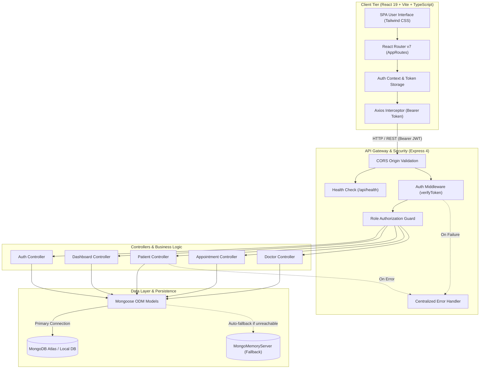
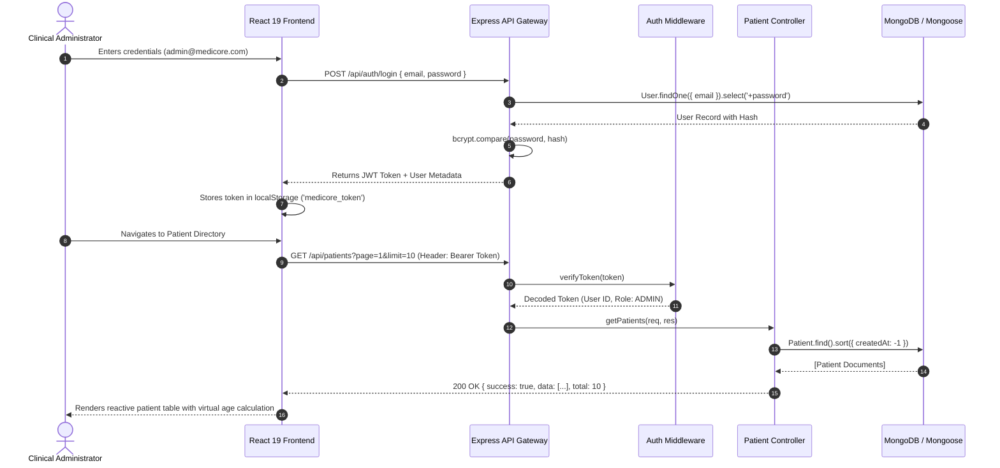
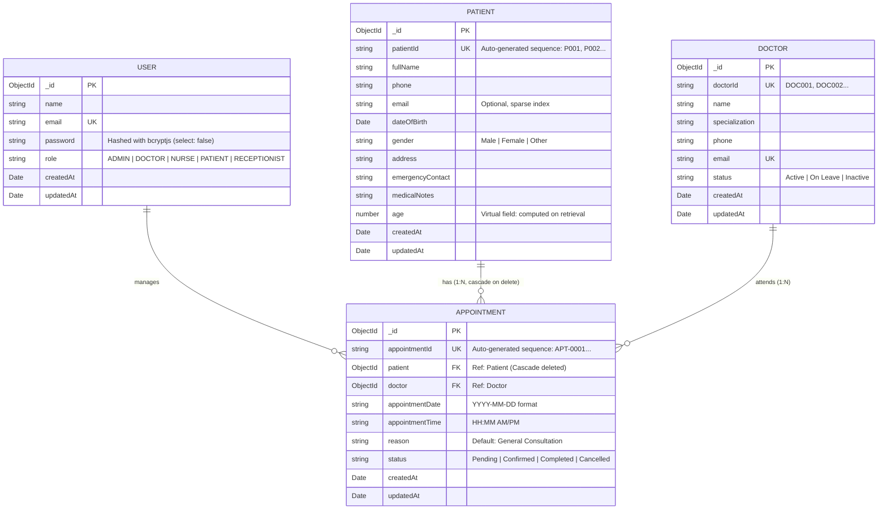
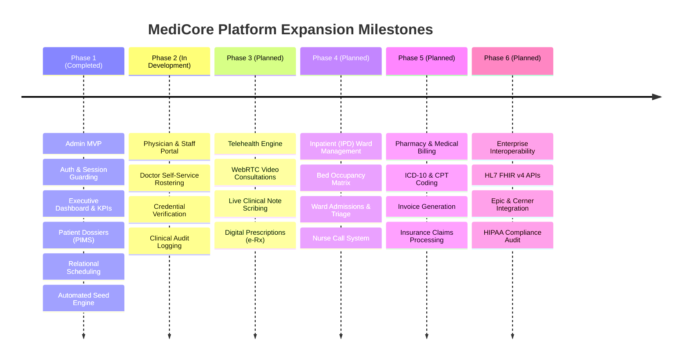

# MediCore — Healthcare Management Platform

<p align="center">
  
</p>

<p align="center">
  <strong>Next-Generation Clinical Operations, Patient Records, and Appointment Scheduling Platform</strong>
  <br />
  <em>Engineered with React 19, Vite, TypeScript, Tailwind CSS, Express, MongoDB Atlas & MongoMemoryServer</em>
</p>

<p align="center">
  <a href="https://react.dev/"></a>
  <a href="https://vite.dev/"></a>
  <a href="https://www.typescriptlang.org/"></a>
  <a href="https://tailwindcss.com/"></a>
  <a href="https://nodejs.org/"></a>
  <a href="https://expressjs.com/"></a>
  <a href="https://www.mongodb.com/"></a>
  <a href="https://mongoosejs.com/"></a>
  <a href="https://playwright.dev/"></a>
  
</p>

---

## Quick Navigation

- [Overview](#overview)
- [Application Preview & Screenshots](#application-preview--screenshots)
  - [Authentication Portal](#1-authentication-portal)
  - [Executive Clinical Dashboard](#2-executive-clinical-dashboard)
  - [Patient Management System (PIMS)](#3-patient-management-system-pims)
  - [Consultation & Appointment Scheduling](#4-consultation--appointment-scheduling)
  - [Clinical Roster & Roadmap Previews](#5-clinical-roster--roadmap-previews)
  - [Responsive Mobile Experience](#6-responsive-mobile-experience)
- [Key Features](#key-features)
- [Technology Stack](#technology-stack)
- [System Architecture & Data Flow](#system-architecture--data-flow)
- [Database & Data Models](#database--data-models)
- [REST API Reference](#rest-api-reference)
- [Repository Structure](#repository-structure)
- [Prerequisites](#prerequisites)
- [Installation & Local Setup](#installation--local-setup)
- [Environment Variables](#environment-variables)
- [Testing & Quality Assurance](#testing--quality-assurance)
- [Security & Compliance](#security--compliance)
- [Production Deployment](#production-deployment)
- [Troubleshooting & FAQs](#troubleshooting--faqs)
- [Strategic Roadmap](#strategic-roadmap)
- [Contributing](#contributing)
- [License & Author](#license--author)

---

## Overview

**MediCore** is a modern, full-stack hospital and healthcare administrative platform engineered to streamline clinical scheduling, patient intake, dossier records, and operational analytics. Built as a high-reliability Admin MVP, it solves the acute administrative bottleneck faced by clinics and outpatient departments: fragmented patient histories, scheduling conflicts, slow lookups, and fragile local database setups.

### Problem It Solves
Traditional clinic management systems are either antiquated on-premise desktop software or prohibitively complex enterprise suites. MediCore bridges this gap with:
1. **Frictionless Onboarding**: A zero-configuration embedded database fallback (`MongoMemoryServer`) that lets evaluators and developers run the full system immediately without installing local database daemons.
2. **Instant Clinical Visibility**: Real-time KPI aggregation and weekly consultation volume analytics powered by Recharts.
3. **Data Integrity & Safety**: Multi-field debounced patient search, automated patient code generation (`P001`, `P002`...), schema-level validation, and two-step modal deletion safeguards with relational cascade cleanup.
4. **Relational Scheduling Engine**: Direct relational linking between patients, clinical specialists, time slots, and consultation statuses with immediate state progression tracking.

### Target Audience
- **Clinical Administrators & Practice Managers**: For daily patient intake, roster coordination, and consultation tracking.
- **Outpatient Care Clinics**: Seeking a responsive, lightweight, cloud-ready management dashboard.
- **Healthcare Software Engineers & Recruiters**: Evaluating modern TypeScript full-stack architecture, clean separation of concerns, and automated end-to-end verification.

---

## Application Preview & Screenshots

All 15 screenshots showcased below are captured directly from the live, running application via automated high-resolution Playwright runs (`deviceScaleFactor: 2`, 1440×900 desktop and 390×844 mobile viewports).

### 1. Authentication Portal

Secure administrative entry point featuring real-time form validation, credential verification, and an accessible password visibility toggle.

<p align="center">
  
  <br />
  <em>Figure 1: MediCore Login Screen featuring JWT credential authentication and accessible Lucide eye visibility toggle.</em>
</p>

---

### 2. Executive Clinical Dashboard

Central command center providing immediate situational awareness with live database metric counters, weekday consultation distributions, and today's consultation agenda.

| Executive Clinical Dashboard | Operational View After Actions |
| :---: | :---: |
|  |  |
| <sub><b>Figure 2A:</b> Live KPI metrics (Patients, Appointments, Doctors, Pending) with Recharts weekly volume chart.</sub> | <sub><b>Figure 2B:</b> Dashboard view dynamically updated after adding patients, rescheduling, and status transitions.</sub> |

---

### 3. Patient Management System (PIMS)

End-to-end patient lifecycle tracking including debounced multi-field searching (name, phone, patient code), gender filtering, detailed clinical dossiers with virtual age calculation, and validated record modification.

| Patient Directory & Search | Comprehensive Clinical Dossier |
| :---: | :---: |
|  |  |
| <sub><b>Figure 3A:</b> Directory featuring instant debounced search, gender filtering, and paginated records.</sub> | <sub><b>Figure 3B:</b> Dossier detailing calculated age, emergency contact, medical alerts, and deletion modal guard.</sub> |

| New Patient Registration | Edit Patient Record |
| :---: | :---: |
|  |  |
| <sub><b>Figure 3C:</b> Validated intake form with automated patient code assignment (`P001`, `P002`...).</sub> | <sub><b>Figure 3D:</b> Record modification interface with pre-populated fields and instant persistence.</sub> |

---

### 4. Consultation & Appointment Scheduling

Relational scheduling connecting patients to specialist doctors with date constraints, time slots, clinical reasons, and color-coded status badges (`Pending` ➔ `Confirmed` ➔ `Completed` ➔ `Cancelled`).

| Appointment Master Table | Create Relational Appointment |
| :---: | :---: |
|  |  |
| <sub><b>Figure 4A:</b> Appointments table with status filters, date selection, and quick action controls.</sub> | <sub><b>Figure 4B:</b> Scheduling modal linking registered patients with active clinical specialists.</sub> |

<p align="center">
  
  <br />
  <em>Figure 4C: Detailed consultation dossier displaying populated doctor specialty, patient demographics, and 1-click status lifecycle controls.</em>
</p>

---

### 5. Clinical Roster & Roadmap Previews

Architected for future enterprise scaling: active seeded medical specialists alongside clearly demarcated roadmap previews for Phase 2 credentialing and HIPAA configuration.

| Active Doctor Roster (Phase 2 Preview) | System Settings & Audit (Phase 2 Preview) |
| :---: | :---: |
|  |  |
| <sub><b>Figure 5A:</b> Active specialist roster with credentials and upcoming self-service physician portal preview.</sub> | <sub><b>Figure 5B:</b> System configuration interface with HIPAA audit logging and EHR integration roadmap.</sub> |

---

### 6. Responsive Mobile Experience

Engineered with mobile-first Tailwind CSS breakpoints (`sm`, `md`, `lg`, `xl`), providing seamless usability for clinical staff on tablets and mobile devices.

| Mobile Dashboard | Mobile Patient Directory | Mobile Appointments Roster |
| :---: | :---: | :---: |
|  |  |  |
| <sub><b>Figure 6A:</b> Responsive KPI grid & volume charts on mobile viewport.</sub> | <sub><b>Figure 6B:</b> Mobile card list with touch-friendly actions and search.</sub> | <sub><b>Figure 6C:</b> Compact appointment agenda with quick status indicators.</sub> |

---

## Key Features

### Implemented & Verified Capabilities

- **Role-Based Authentication & Guarded Routes**:
  - Encrypted credential verification utilizing `bcryptjs` (10 salt rounds).
  - Stateless JSON Web Tokens (`jsonwebtoken`) with 7-day expiration.
  - Client-side route protection via React Router `<ProtectedRoute>` wrapping layout components.
  - Automatic session teardown and token clearance upon `401 Unauthorized` responses.
  - Interactive password visibility toggling (`Eye` / `EyeOff`) with accessible ARIA labeling.

- **Executive Analytics & KPI Dashboard**:
  - Live database counters: Total Patients, Today's Scheduled Appointments, Total Doctors, and Pending Consultations.
  - Interactive Weekly Volume Bar Chart powered by `recharts`.
  - Today's Consultation Agenda table with instantaneous status indicators.
  - One-click shortcuts for rapid patient intake and appointment booking.

- **Comprehensive Patient Management (PIMS)**:
  - Full CRUD operations with server-enforced validation schemas.
  - Debounced multi-field searching against `fullName`, `phone`, `email`, and `patientId`.
  - Demographic filtering by gender (`All`, `Male`, `Female`, `Other`).
  - Dynamic virtual age calculation dynamically derived from `dateOfBirth`.
  - Two-step deletion confirmation modal with cascading cleanup of associated appointment records.

- **Relational Appointment Scheduling**:
  - Relational population linking Mongoose `Patient` and `Doctor` schemas.
  - Validation rules guarding against scheduling appointments in past dates.
  - One-click lifecycle state transitions (`Pending` ➔ `Confirmed` ➔ `Completed` ➔ `Cancelled`).
  - Search and filter appointments by patient name, doctor name, status, or consultation date.

- **Resilient Dual-Engine Persistence**:
  - Primary connection to MongoDB / MongoDB Atlas via `MONGODB_URI`.
  - Automatic zero-configuration fallback to an embedded in-memory database (`mongodb-memory-server`) if external MongoDB is unreachable or unconfigured.
  - Automated startup seeding (`seed.ts`) populating default administrator accounts, 5 medical specialists, 10 patients, and 12 relational appointments.

### Planned Modules (Roadmap Preview)

- **Phase 2 — Doctor & Staff Portal**: Physician self-service scheduling, leave requests, and digital credentials.
- **Phase 3 — Telehealth Consultations**: End-to-end encrypted WebRTC video calls with real-time clinical notes.
- **Phase 4 — Inpatient (IPD) Ward Management**: Bed occupancy matrices, ward admission/discharge, and triage workflows.
- **Phase 5 — Electronic Prescriptions (e-Rx)**: Formulary integration, drug-drug interaction alerts, and dispensing tracking.
- **Phase 6 — Medical Billing & Claims**: ICD-10/CPT coding engines, automated invoice generation, and insurance claims.
- **Phase 7 — EHR / FHIR Interoperability**: Bi-directional integration with Epic, Cerner, and HL7 FHIR v4 endpoints.

---

## Technology Stack

### Frontend Architecture
| Technology | Version | Purpose |
| :--- | :--- | :--- |
| **React** | `^19.2.8` | Component-based reactive UI rendering |
| **Vite** | `^8.3.0` | Ultra-fast build tool and local development HMR server |
| **TypeScript** | `~6.0.2` | End-to-end static type safety and contract enforcement |
| **Tailwind CSS** | `^3.4.19` | Utility-first styling with custom clinical color palette |
| **React Router** | `^7.18.4` | Client-side routing with guarded layout wrappers |
| **Recharts** | `^3.10.1` | Declarative SVG charting for consultation statistics |
| **Lucide React** | `^1.52.0` | Accessible, consistent icon library |
| **Axios** | `^1.20.0` | Promise-based HTTP client with auth interceptors |
| **Oxlint** | `^1.81.0` | High-performance static JavaScript/TypeScript linter |

### Backend Architecture
| Technology | Version | Purpose |
| :--- | :--- | :--- |
| **Node.js** | `18+` / `20+` | Server JavaScript runtime environment |
| **Express.js** | `^4.19.2` | RESTful HTTP routing framework and middleware pipeline |
| **TypeScript** | `^5.5.3` | Strongly-typed backend controller, model, and route logic |
| **Mongoose** | `^8.5.1` | Object Data Modeling (ODM) for MongoDB schemas and virtuals |
| **bcryptjs** | `^2.4.3` | Cryptographic password hashing (10 salt rounds) |
| **jsonwebtoken** | `^9.0.2` | Stateless HMAC-SHA256 bearer token authentication |
| **CORS** | `^2.8.5` | Cross-Origin Resource Sharing middleware |
| **dotenv** | `^16.4.5` | Twelve-factor application environment configuration |
| **ts-node-dev** | `^2.0.0` | Live-reloading TypeScript execution for development |

### Persistence & Storage
| Technology | Version | Purpose |
| :--- | :--- | :--- |
| **MongoDB Atlas** | `v6.0+` | Scalable cloud document database for production |
| **Local MongoDB** | `v6.0+` | Standard local database daemon on port 27017 |
| **MongoMemoryServer** | `^9.4.0` | In-memory zero-configuration MongoDB engine fallback |

### Quality Assurance & DevOps
| Technology | Version | Purpose |
| :--- | :--- | :--- |
| **Playwright** | `^1.64.0` | Headless Chromium end-to-end testing & screenshot automation |
| **Concurrently** | `^9.1.2` | Unified multi-process execution for full-stack dev |
| **PowerShell & Batch** | Native | 1-click Windows execution scripts (`run.ps1`, `run.bat`) |

---

## System Architecture & Data Flow

### Architecture Overview



### Data Flow Lifecycle



---

## Database & Data Models

### Entity-Relationship Diagram (ERD)



### Schema Details & Indexes

1. **User Schema (`User.ts`)**:
   - `email`: Indexed, unique, lowercase, trimmed.
   - `password`: Excluded by default (`select: false`), hashed before persistence via Mongoose pre-save hook.
   - Role default: `'ADMIN'`.

2. **Patient Schema (`Patient.ts`)**:
   - `patientId`: Indexed, unique, sequentially formatted (`P001`, `P002`...).
   - `phone` & `fullName`: Indexed for rapid substring search regex.
   - Virtual `age`: Calculated automatically from `dateOfBirth` relative to current system date on JSON/Object serialization.
   - Cascading Cleanup: Deleting a patient invokes `Appointment.deleteMany({ patient: patient._id })` before removing the dossier.

3. **Doctor Schema (`Doctor.ts`)**:
   - `doctorId`: Unique identifier (`DOC001`, `DOC002`...).
   - `status`: Enum constraint (`'Active'`, `'On Leave'`, `'Inactive'`).

4. **Appointment Schema (`Appointment.ts`)**:
   - `appointmentId`: Unique identifier (`APT-0001`, `APT-0002`...).
   - `patient` & `doctor`: Indexed `Schema.Types.ObjectId` references populated via Mongoose `.populate()`.
   - `appointmentDate`: Indexed string format (`YYYY-MM-DD`) supporting day-level filtering.
   - `status`: Indexed enum constraint (`'Pending'`, `'Confirmed'`, `'Completed'`, `'Cancelled'`).

---

## REST API Reference

All protected endpoints require an HTTP header: `Authorization: Bearer <JWT_TOKEN>`.

### Authentication Endpoints (`/api/auth`)

| Method | Endpoint | Access | Description | Request Body |
| :--- | :--- | :--- | :--- | :--- |
| `POST` | `/api/auth/login` | Public | Authenticates credentials and issues JWT | `{"email": "admin@medicore.com", "password": "..."}` |
| `GET` | `/api/auth/me` | Bearer Token | Retrieves active authenticated user session | _None_ |

<details>
<summary>▶ View Sample Login Response</summary>

```json
{
  "success": true,
  "message": "Authentication successful.",
  "data": {
    "token": "eyJhbGciOiJIUzI1NiIsInR5cCI6IkpXVCJ9...",
    "user": {
      "id": "6704ca98b3f46f4812a10123",
      "name": "MediCore Administrator",
      "email": "admin@medicore.com",
      "role": "ADMIN"
    }
  }
}
```
</details>

---

### Dashboard Endpoints (`/api/dashboard`)

| Method | Endpoint | Access | Description | Query Parameters |
| :--- | :--- | :--- | :--- | :--- |
| `GET` | `/api/dashboard/stats` | Bearer Token | Live KPI counters (patients, appointments, doctors, pending) | _None_ |
| `GET` | `/api/dashboard/today-appointments` | Bearer Token | List of consultations scheduled for today (or nearest 6 active) | _None_ |
| `GET` | `/api/dashboard/appointment-statistics` | Bearer Token | Weekday breakdown of completed vs total appointments for chart | _None_ |

<details>
<summary>▶ View Sample KPI Stats Response</summary>

```json
{
  "success": true,
  "data": {
    "totalPatients": 10,
    "todaysAppointments": 3,
    "totalDoctors": 5,
    "pendingAppointments": 4
  }
}
```
</details>

---

### Patient Endpoints (`/api/patients`)

| Method | Endpoint | Access | Description | Query Parameters / Body |
| :--- | :--- | :--- | :--- | :--- |
| `GET` | `/api/patients` | Bearer Token | Paginated query with multi-field search and gender filter | `?page=1&limit=10&search=Smith&gender=Male` |
| `GET` | `/api/patients/:id` | Bearer Token | Fetches complete patient dossier with virtual age | URL parameter `:id` |
| `POST` | `/api/patients` | Bearer Token | Creates new patient with auto-generated `patientId` | `{"fullName": "...", "phone": "...", "dateOfBirth": "...", "gender": "..."}` |
| `PUT` | `/api/patients/:id` | Bearer Token | Updates demographic and clinical record data | Partial or full patient fields |
| `DELETE` | `/api/patients/:id` | Bearer Token | Safely deletes patient record and cascades to appointments | URL parameter `:id` |

---

### Appointment Endpoints (`/api/appointments`)

| Method | Endpoint | Access | Description | Query Parameters / Body |
| :--- | :--- | :--- | :--- | :--- |
| `GET` | `/api/appointments` | Bearer Token | Paginated appointments with doctor and patient populated | `?page=1&limit=10&search=&status=Pending&date=` |
| `GET` | `/api/appointments/:id` | Bearer Token | Fetches full consultation dossier with populated references | URL parameter `:id` |
| `POST` | `/api/appointments` | Bearer Token | Schedules consultation (future date guard enforced) | `{"patient": "...", "doctor": "...", "appointmentDate": "...", "appointmentTime": "..."}` |
| `PUT` | `/api/appointments/:id` | Bearer Token | Modifies consultation details or transitions status | `{"status": "Confirmed"}` |
| `DELETE` | `/api/appointments/:id` | Bearer Token | Cancels and permanently removes appointment record | URL parameter `:id` |

---

### Doctor & System Endpoints (`/api/doctors`, `/api/health`)

| Method | Endpoint | Access | Description |
| :--- | :--- | :--- | :--- |
| `GET` | `/api/doctors` | Bearer Token | Retrieves active clinical doctor roster sorted by name |
| `GET` | `/api/health` | Public | System health check reporting uptime status and timestamp |

---

## Repository Structure

```
medicore/
├── client/                                 # Frontend SPA (React 19 + Vite + TypeScript)
│   ├── public/                             # Static assets, SVG icons, and hero photography
│   │   ├── images/                         # Physician profile portraits & login graphics
│   │   ├── favicon.svg                     # MediCore brand SVG icon
│   │   └── icons.svg                       # Vector sprites
│   ├── src/
│   │   ├── assets/                         # Vector branding assets
│   │   ├── components/
│   │   │   ├── common/                     # Button, Input, Select, Modal, ConfirmDialog, Skeletons
│   │   │   ├── dashboard/                  # StatCard, AppointmentTable, AppointmentChart, QuickActionCard
│   │   │   └── layout/                     # AppLayout, Header, Sidebar, Navigation Items
│   │   ├── context/                        # AuthContext (JWT state), ToastContext (user feedback)
│   │   ├── hooks/                          # useAuth, useToast, useDebounce custom hooks
│   │   ├── pages/                          # Login, Dashboard, Patients, Appointments, Doctors, Settings
│   │   ├── routes/                         # AppRoutes.tsx, ProtectedRoute.tsx (access guards)
│   │   ├── services/                       # api.ts (Axios), authService, patientService, appointmentService
│   │   ├── types/                          # TypeScript contracts (IPatient, IAppointment, IDoctor, IUser)
│   │   ├── utils/                          # Age calculation, currency, date formatting helpers
│   │   ├── App.tsx                         # Top-level React provider tree
│   │   ├── main.tsx                        # DOM mount root
│   │   └── index.css                       # Tailwind directives and clinical design tokens
│   ├── tailwind.config.js                  # Custom palette extensions
│   ├── tsconfig.json                       # Client TypeScript configuration
│   └── vite.config.ts                      # Vite build plugins and dev proxy configuration
│
├── server/                                 # Backend REST API (Node.js + Express + TypeScript)
│   ├── src/
│   │   ├── config/
│   │   │   └── db.ts                       # Dual-engine connection (MongoDB Atlas + MongoMemoryServer)
│   │   ├── controllers/
│   │   │   ├── authController.ts           # Login verification, session me, token generation
│   │   │   ├── dashboardController.ts      # KPI aggregation, weekly statistics, agenda
│   │   │   ├── patientController.ts        # PIMS CRUD, debounced query, auto-ID sequence, cascade delete
│   │   │   ├── appointmentController.ts    # Relational scheduling, past-date guards, status transitions
│   │   │   └── doctorController.ts         # Active medical specialist roster query
│   │   ├── middleware/
│   │   │   ├── authMiddleware.ts           # Bearer token verification and role guards
│   │   │   └── errorHandler.ts             # Centralized HTTP error sanitization
│   │   ├── models/
│   │   │   ├── User.ts                     # Admin credentials, bcrypt hooks, role enum
│   │   │   ├── Patient.ts                  # Patient demographics, medical notes, virtual age
│   │   │   ├── Doctor.ts                   # Physician credentials, specialties, availability
│   │   │   └── Appointment.ts              # Relational consultation linkage with date/status
│   │   ├── routes/                         # Express sub-routers mounted under /api/*
│   │   ├── services/
│   │   │   └── seed.ts                     # Automated clinical database seeder
│   │   ├── utils/
│   │   │   └── jwt.ts                      # JWT signing and verification utilities
│   │   ├── types/                          # Server TypeScript types and Express Request extensions
│   │   ├── app.ts                          # Express application configuration, CORS, routes
│   │   └── server.ts                       # HTTP server bootstrap and port listener
│   ├── tsconfig.json                       # Server TypeScript compiler options
│   └── .env.example                        # Server environment variable template
│
├── screenshots/                            # 15 high-definition Playwright test captures
├── scripts/
│   └── capture_screenshots.js              # Automated Playwright E2E runner & screenshot pipeline
├── run.bat                                 # Windows 1-Click Launch Script (Batch)
├── run.ps1                                 # Windows 1-Click Launch Script (PowerShell)
├── package.json                            # Root workspace scripts & concurrency orchestration
├── .env.example                            # Root environment variable template
├── .gitignore                              # Git exclusion rules
└── README.md                               # Project documentation
```

---

## Prerequisites

Before running MediCore, ensure your environment meets these runtime requirements:

| Dependency | Minimum Version | Recommended Version | Verification Command |
| :--- | :--- | :--- | :--- |
| **Node.js** | `v18.0.0` | `v20.x` or `v22.x` | `node -v` |
| **npm** | `v9.0.0` | `v10.x` | `npm -v` |
| **MongoDB** *(Optional)* | `v6.0+` | MongoDB Atlas or Local | `mongod --version` |

> [!NOTE]
> **No Database Installation Required!** If you do not have MongoDB installed or running locally, MediCore automatically initializes an embedded `MongoMemoryServer` engine in memory. You can run and evaluate the application immediately out of the box.

---

## Installation & Local Setup

### 1. Clone the Repository
```bash
git clone https://github.com/manishvenki/MediCore.git
cd MediCore
```

### 2. Install Dependencies
You can install dependencies across the entire workspace from the root:

```bash
# Install root orchestration packages
npm install

# Install server packages
npm install --prefix server

# Install client packages
npm install --prefix client
```

### 3. Configure Environment Variables
Copy the template files for both server and client:

```bash
# Server configuration
cp server/.env.example server/.env

# Client configuration
cp client/.env.example client/.env
```

*(On Windows PowerShell, use `Copy-Item server/.env.example server/.env` and `Copy-Item client/.env.example client/.env`)*

---

### 4. Running the Application

Choose any of the following verified execution methods:

#### Method A: Windows 1-Click Script (Recommended for Windows)
Double-click `run.bat` or execute in Command Prompt:
```cmd
.\run.bat
```
Or execute the PowerShell equivalent:
```powershell
.\run.ps1
```
*This launches the backend on port 5000 and the frontend on port 5173 in dedicated terminal windows, waits 4 seconds for database initialization, and automatically opens your default browser at `http://localhost:5173`.*

#### Method B: Unified Root Script (Cross-Platform)
From the project root:
```bash
npm run dev
```
*Uses `concurrently` to run both `dev:server` and `dev:client` in a single terminal with color-coded prefixes (`BACKEND` in blue, `FRONTEND` in green).*

#### Method C: Independent Terminal Execution

**Terminal 1 — Backend Server:**
```bash
cd server
npm run dev
# Server listening at http://localhost:5000
# Health check at http://localhost:5000/api/health
```

**Terminal 2 — Frontend Client:**
```bash
cd client
npm run dev
# Client running at http://localhost:5173
```

---

### 5. Accessing the Platform & Seed Credentials

Open your web browser and navigate to:
**`http://localhost:5173`**

On initial startup, MediCore's automatic database seeder initializes the clinical database with default demo records:

| Role | Email | Password | Pre-loaded Data |
| :--- | :--- | :--- | :--- |
| **Administrator** | `admin@medicore.com` | `Admin@123` | Full administrative access to dashboard, patients, and scheduling |

**Pre-Seeded Clinical Dataset**:
- **5 Medical Specialists**: Dr. John Smith (General Medicine), Dr. Priya Kumar (Cardiology), Dr. David Lee (Orthopedics), Dr. Sarah Johnson (Pediatrics), Dr. Michael Chen (Neurology).
- **10 Patients**: Realistic demographic records spanning varying age brackets, emergency contacts, and medical alerts.
- **12 Relational Consultations**: Distributed across past, present, and future dates with diverse consultation statuses (`Confirmed`, `Pending`, `Completed`, `Cancelled`).

---

## Environment Variables

### Server Configuration (`server/.env`)

| Variable | Type | Default / Example Value | Description |
| :--- | :--- | :--- | :--- |
| `PORT` | Number | `5000` | Port on which Express HTTP server listens |
| `NODE_ENV` | String | `development` | Environment mode (`development` or `production`) |
| `MONGODB_URI` | String | `mongodb://localhost:27017/medicore` | MongoDB connection URI. If unreachable, `MongoMemoryServer` starts automatically |
| `JWT_SECRET` | String | `medicore_super_secret_jwt_key_2026_demo` | Secret key used to sign and verify HMAC-SHA256 bearer tokens |
| `CLIENT_URL` | String | `http://localhost:5173` | Trusted frontend origin for CORS policy |

### Client Configuration (`client/.env`)

| Variable | Type | Default / Example Value | Description |
| :--- | :--- | :--- | :--- |
| `VITE_API_URL` | String | `http://localhost:5000/api` | Base URL of the backend REST API consumed by Axios |

> [!WARNING]
> **Production Notice**: Never commit production secrets, database credentials, or real JWT keys to version control. In production, provide strong random 256-bit strings for `JWT_SECRET` through your hosting provider's secrets manager.

---

## Testing & Quality Assurance

### Automated End-to-End Test & Screenshot Pipeline

MediCore includes an automated test script (`scripts/capture_screenshots.js`) built with **Playwright**. It validates full end-to-end user workflows and generates high-DPI screenshots:

```bash
# Ensure both backend (port 5000) and frontend (port 5173) are running, then run:
node scripts/capture_screenshots.js
```

**Automated Test Flow Verified by Script**:
1. Launches headless Chromium browser with 1440×900 desktop viewport (`deviceScaleFactor: 2`).
2. Navigates to `/login`, fills credentials, verifies password eye visibility toggle (`Eye`/`EyeOff`), and captures `01-login.png`.
3. Submits login, awaits session validation, and redirects to `/dashboard` to capture `02-dashboard.png`.
4. Navigates to `/patients`, verifies search and pagination, and captures `03-patients-list.png`.
5. Drills down into the first patient dossier, tests delete confirmation modal opening/cancellation, and captures `04-patient-details.png`.
6. Enters `/patients/new`, registers a new patient record with complete demographic fields, and captures `05-add-patient.png`.
7. Navigates to patient edit view, verifies pre-populated data, and captures `06-edit-patient.png`.
8. Navigates to `/appointments`, tests status and date filters, and captures `07-appointments-list.png`.
9. Opens `/appointments/new`, schedules a relational appointment connecting patient and physician, and captures `08-create-appointment.png`.
10. Views appointment consultation dossier and captures `09-appointment-details.png`.
11. Inspects roadmap preview modules at `/doctors` (`10-doctors-coming-soon.png`) and `/settings` (`11-settings-coming-soon.png`).
12. Resizes viewport to mobile dimensions (390×844) to validate responsive layouts across Dashboard, Patients, and Appointments (`12`, `13`, `14`).
13. Returns to executive dashboard to verify updated KPI counters and captures `15-final-dashboard-after-actions.png`.

### Code Verification & Build Commands

```bash
# Verify client code quality with Oxlint
npm run lint --prefix client

# Build and verify backend TypeScript compilation
npm run build:server

# Build and verify client TypeScript and Vite production bundle
npm run build:client

# Full workspace build verification
npm run build
```

---

## Security & Compliance

1. **Cryptographic Credential Protection**:
   - Administrative passwords are never stored in plaintext. Passwords undergo irreversible salt-hashed encryption via `bcryptjs` (10 rounds).
   - In Mongoose schemas, passwords use `{ select: false }` to prevent accidental inclusion in API queries or serialization.

2. **Stateless JWT Authorization**:
   - Standardized Bearer token verification via `authMiddleware.ts`.
   - Access to `/api/patients`, `/api/appointments`, `/api/dashboard`, and `/api/doctors` strictly guarded against unauthorized callers.

3. **CORS Isolation**:
   - Strict origin filtering allowing only trusted client applications (`http://localhost:5173` or configured `CLIENT_URL`) to access resources.

4. **Input Sanitization & Validation**:
   - Server-enforced required fields, date constraints, and enum checking guard against injection and corrupt states.
   - Front-end validation prevents invalid or past-dated consultation submissions.

5. **Safe Record Deletion**:
   - Two-step UI confirmation modal prevents accidental record destruction.
   - Deleting a patient triggers cascade cleanup to avoid orphaned appointment references in the database.

6. **HIPAA Readiness Architecture**:
   - Schema separation and field-level metadata prepared for audit trails.
   - Centralized error handling prevents leaking internal stack traces or database connection strings to client responses.

---

## Production Deployment

### Frontend Deployment (Vercel / Netlify / Cloudflare Pages)

1. Connect your repository to your hosting provider.
2. Configure build settings:
   - **Root Directory**: `client`
   - **Build Command**: `npm run build`
   - **Output Directory**: `dist`
3. Add Environment Variable:
   - `VITE_API_URL`: `https://your-backend-api.onrender.com/api`
4. Set up client-side rewrite rule for single-page applications:
   - **Vercel** (`client/vercel.json`):
     ```json
     {
       "rewrites": [{ "source": "/(.*)", "destination": "/index.html" }]
     }
     ```
   - **Netlify** (`client/_redirects`):
     ```text
     /*    /index.html   200
     ```

### Backend Deployment (Render / Railway / AWS / DigitalOcean)

1. Connect repository with root directory set to `server`.
2. Configure build and start commands:
   - **Build Command**: `npm install && npm run build`
   - **Start Command**: `npm start` (executes `node dist/server.js`)
3. Configure Production Environment Variables:
   - `PORT`: `5000` (or host assigned port)
   - `NODE_ENV`: `production`
   - `MONGODB_URI`: `mongodb+srv://<db_user>:<db_password>@cluster0.yourdomain.mongodb.net/medicore?retryWrites=true&w=majority`
   - `JWT_SECRET`: `<generated-secure-256-bit-token>`
   - `CLIENT_URL`: `https://your-medicore-frontend.vercel.app`

---

## Troubleshooting & FAQs

<details>
<summary><b>Q1: MongoDB is not installed locally. Will the project still run?</b></summary>
<br />
<b>Yes!</b> MediCore includes an embedded database fallback. If <code>MONGODB_URI</code> is absent or local MongoDB (port 27017) is not running, the server automatically starts an in-memory <code>MongoMemoryServer</code> instance. All schemas, seeding, queries, and mutations will work identically.
</details>

<details>
<summary><b>Q2: Getting <code>EADDRINUSE: address already in use :::5000</code>?</b></summary>
<br />
Another process is occupying port 5000. You can free port 5000 on Windows by running:
<pre><code>netstat -ano | findstr :5000
taskkill /PID &lt;PID&gt; /F</code></pre>
Alternatively, change <code>PORT=5001</code> in <code>server/.env</code> and update <code>VITE_API_URL=http://localhost:5001/api</code> in <code>client/.env</code>.
</details>

<details>
<summary><b>Q3: Windows localhost resolution issues with MongoDB?</b></summary>
<br />
On certain Windows systems, <code>localhost</code> resolves to IPv6 (<code>::1</code>) rather than IPv4 (<code>127.0.0.1</code>). MediCore's <code>db.ts</code> explicitly catches this exception and automatically retries with IPv4 (<code>127.0.0.1:27017</code>) before falling back to in-memory mode.
</details>

<details>
<summary><b>Q4: What happens if my JWT authentication token expires?</b></summary>
<br />
The client Axios response interceptor intercepts <code>401 Unauthorized</code> responses, clears stored session tokens from <code>localStorage</code>, and automatically redirects the user to <code>/login</code> with an informative session expiration notice.
</details>

---

## Strategic Roadmap



---

## Contributing

Contributions, issues, and feature requests are welcome! To contribute to MediCore:

1. **Fork the Repository** on GitHub.
2. **Create a Feature Branch**:
   ```bash
   git checkout -b feature/clinical-enhancement
   ```
3. **Commit Your Changes**:
   ```bash
   git commit -m "feat: implement doctor credential verification modal"
   ```
4. **Push to Your Branch**:
   ```bash
   git push origin feature/clinical-enhancement
   ```
5. **Open a Pull Request**: Submit your pull request to the `main` branch with a clear description of changes.

---

## License & Author

### License
This project is licensed under the **ISC License**. See the `package.json` specification for details.

### Author & Engineering
- **Project**: MediCore Healthcare Management Platform
- **Lead Developer**: **Manish Venki** ([GitHub Profile](https://github.com/manishvenki))
- **Repository**: [https://github.com/manishvenki/MediCore](https://github.com/manishvenki/MediCore)
- **Built With**: React 19, TypeScript, Tailwind CSS, Express.js, MongoDB Atlas, Mongoose, and Playwright.

---

<p align="center">
  <sub>MediCore Healthcare Management Platform &bull; Designed and engineered for clinical operational excellence.</sub>
</p>
