# MediCore — Healthcare Management Platform

<p align="center">
  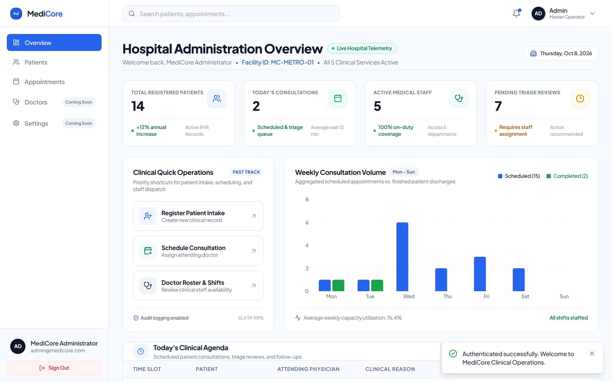
</p>

<p align="center">
  <strong>Next-Generation Clinical Operations, Patient Records, and Appointment Scheduling Platform</strong>
  <br />
  <em>Simplifying Healthcare Administration & Connecting Patients With Care Providers</em>
</p>

<p align="center">
  <a href="https://react.dev/"></a>
  <a href="https://vite.dev/"></a>
  <a href="https://www.typescriptlang.org/"></a>
  <a href="https://tailwindcss.com/"></a>
  <a href="https://nodejs.org/"></a>
  <a href="https://expressjs.com/"></a>
  <a href="https://www.mongodb.com/"></a>
  <a href="https://mongoosejs.com/"></a>
  <a href="https://playwright.dev/"></a>
  <a href="https://github.com/manishvenki/MediCore/blob/main/package.json"></a>
</p>

---

## Quick Navigation

- [Overview](#overview)
  - [Vision & Purpose](#vision--purpose)
  - [The Problem MediCore Solves](#the-problem-medicore-solves)
  - [Target Users & Stakeholders](#target-users--stakeholders)
- [Application Preview & Screenshots](#application-preview--screenshots)
  - [1. Authentication Portal](#1-authentication-portal)
  - [2. Executive Clinical Dashboard](#2-executive-clinical-dashboard)
  - [3. Patient Management System (PIMS)](#3-patient-management-system-pims)
  - [4. Consultation & Appointment Scheduling](#4-consultation--appointment-scheduling)
  - [5. Clinical Roster & Administration Previews](#5-clinical-roster--administration-previews)
  - [6. Responsive Mobile Experience](#6-responsive-mobile-experience)
- [Feature Status: Implemented vs. Planned](#feature-status-implemented-vs-planned)
  - [Currently Implemented (Verified MVP)](#currently-implemented-verified-mvp)
  - [Planned / Coming Soon](#planned--coming-soon)
- [Future Roadmap: Patient Portal & Digital Healthcare Experience](#future-roadmap-patient-portal--digital-healthcare-experience)
  - [A. Patient Registration and Authentication](#a-patient-registration-and-authentication)
  - [B. Book Appointments From Home](#b-book-appointments-from-home)
  - [C. Personalized Patient Dashboard](#c-personalized-patient-dashboard)
  - [D. Doctor Discovery and Availability](#d-doctor-discovery-and-availability)
  - [E. Notifications and Reminders](#e-notifications-and-reminders)
  - [F. Online Consultation — Future Telehealth Extension](#f-online-consultation--future-telehealth-extension)
  - [G. Patient Records and Medical History](#g-patient-records-and-medical-history)
  - [H. Appointment Management for Healthcare Providers](#h-appointment-management-for-healthcare-providers)
  - [I. Future Payments — Optional Enhancement](#i-future-payments--optional-enhancement)
  - [Proposed Patient Appointment Booking Flowchart](#proposed-patient-appointment-booking-flowchart)
- [Technology Stack](#technology-stack)
- [System Architecture & Data Flow](#system-architecture--data-flow)
- [Database & Data Models](#database--data-models)
- [REST API Reference](#rest-api-reference)
- [Repository Structure](#repository-structure)
- [Prerequisites](#prerequisites)
- [Installation & Local Setup](#installation--local-setup)
- [Environment Variables](#environment-variables)
- [Testing & Quality Assurance](#testing--quality-assurance)
- [Security & Compliance](#security--compliance)
- [Production Deployment](#production-deployment)
- [Troubleshooting & FAQs](#troubleshooting--faqs)
- [Strategic Platform Milestones](#strategic-platform-milestones)
- [Contributing](#contributing)
- [License & Author](#license--author)

---

## Overview

### Vision & Purpose
**MediCore** is a modern healthcare management platform engineered to simplify clinical administration, reduce scheduling overhead, and bridge the digital divide between patients and healthcare providers.

At its core, MediCore’s vision is to make healthcare services **accessible, organized, and convenient** through digital technology. Modern outpatient care requires eliminating administrative fragmentation: patients should not need to travel to a clinic merely to book a consultation, and medical administrators should not rely on disparate spreadsheets or vulnerable paper dossiers. MediCore transforms clinical workflows into a unified, secure, and intuitive digital hub.

```
       Healthcare Administration                     Patient Care Delivery
  [Clinical Roster & KPI Analytics]  ◄─── MediCore ───►  [Home Booking & Consultations]
```

### The Problem MediCore Solves
Healthcare facilities operate in high-tempo environments where administrative friction directly degrades patient care. MediCore tackles the critical failure points of traditional management:

1. **Eliminating Zero-Setup Blockers**: Traditional enterprise software requires complex on-premise infrastructure. MediCore features an intelligent dual-engine architecture: it connects directly to production **MongoDB Atlas** or local databases, while providing a transparent in-memory fallback (`MongoMemoryServer`) that lets evaluators launch the complete system immediately without installing database daemons.
2. **Eliminating In-Person Scheduling Inefficiencies**: Patients traditionally endure long telephone queues or in-person visits to book consultations. MediCore’s architecture supports structured digital scheduling with real-time doctor availability checks.
3. **Preventing Medical Record Fragmentation**: Patient data is centralized into structured dossiers containing contact details, calculated age, demographic records, emergency contacts, and medical alerts.
4. **Enforcing Relational Integrity & Safeguards**: Relational Mongoose references connect patients directly with attending physicians, featuring automatic cascade cleanup upon patient record deletion and two-step modal confirmation guards.

### Target Users & Stakeholders
- **Clinical Administrators & Medical Receptionists**: Manage daily patient intake, oversee calendar schedules, monitor waiting room statuses, and track KPI metrics.
- **Attending Physicians & Specialists**: View daily consultation agendas, inspect demographic and clinical dossiers, and transition consultation statuses.
- **Patients (Future Digital Portal)**: Discover specialists, view verified credentials, book consultations from home, access appointments, and receive automated reminders.
- **Healthcare Technical Recruiters & Engineers**: Evaluating modern full-stack TypeScript architecture, resilient dual-database persistence, and automated Playwright verification.

---

## Application Preview & Screenshots

All 15 screenshots showcased below represent real, verified captures generated by automated Playwright runs (`deviceScaleFactor: 2`, 1440×900 desktop and 390×844 mobile viewports) directly against the live application.

### 1. Authentication Portal

Secure administrative gateway featuring real-time input validation, bcrypt credential verification, and an accessible Lucide eye visibility toggle.

<p align="center">
  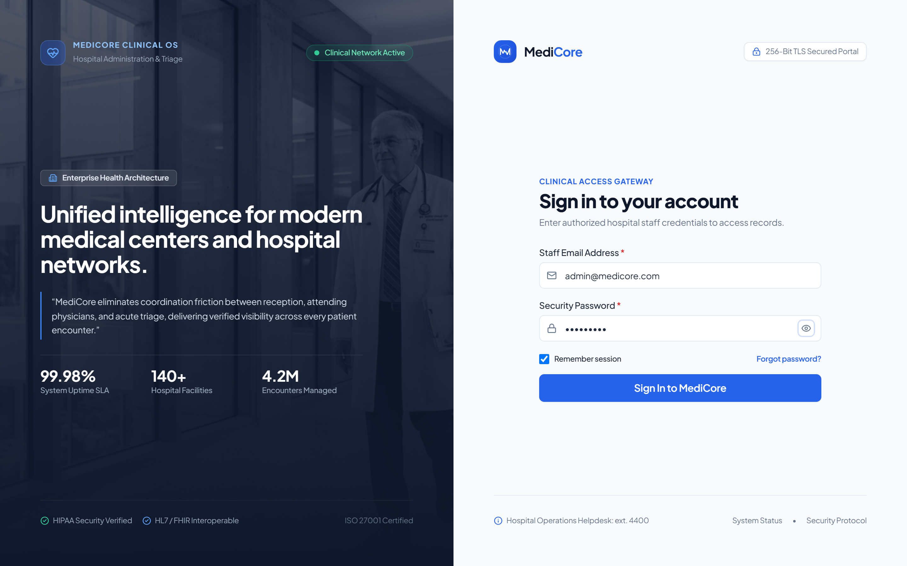
  <br />
  <em>Figure 1: MediCore Administrative Authentication Portal featuring password toggle, JWT authorization, and preloaded demo credentials.</em>
</p>

---

### 2. Executive Clinical Dashboard

Operational overview providing real-time database counters, weekday consultation distributions, and today's consultation agenda.

| Executive Clinical Dashboard | Operational View After Actions |
| :---: | :---: |
|  | 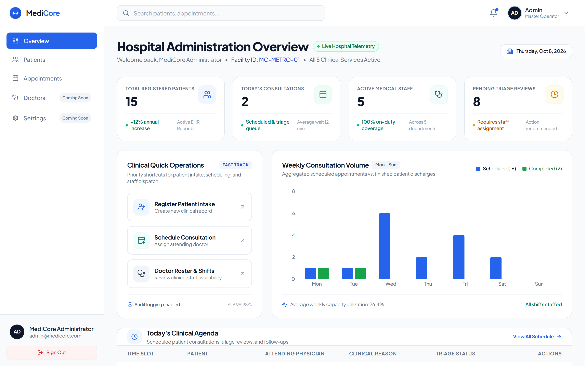 |
| <sub><b>Figure 2A:</b> Live KPI metrics (Patients, Appointments, Doctors, Pending) with Recharts weekly volume chart.</sub> | <sub><b>Figure 2B:</b> Dashboard view dynamically updated after adding patients, rescheduling, and status transitions.</sub> |

---

### 3. Patient Management System (PIMS)

End-to-end patient dossier lifecycle tracking including debounced multi-field searching, gender filtering, virtual age computation, and validated record intake.

| Patient Directory & Search | Comprehensive Clinical Dossier |
| :---: | :---: |
| 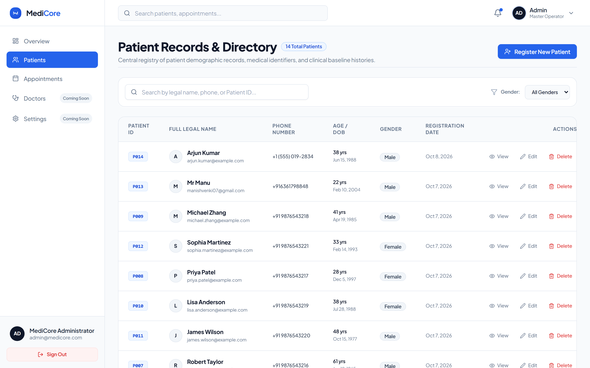 | 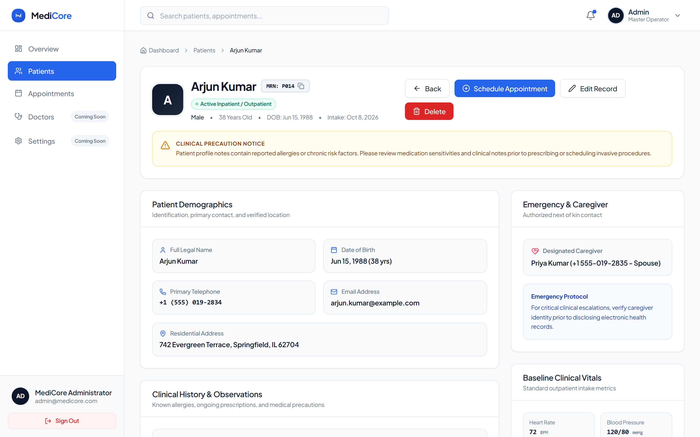 |
| <sub><b>Figure 3A:</b> Directory featuring instant debounced search, gender filtering, and paginated records.</sub> | <sub><b>Figure 3B:</b> Dossier detailing calculated age, emergency contact, medical alerts, and deletion modal guard.</sub> |

| New Patient Registration | Edit Patient Record |
| :---: | :---: |
| 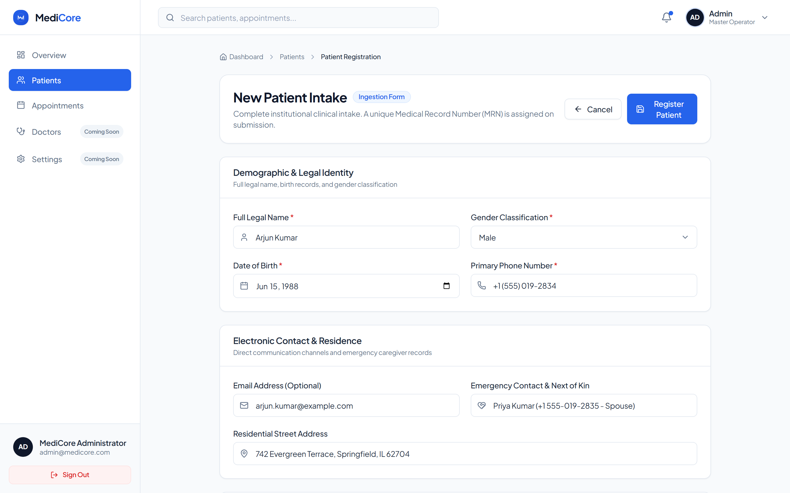 | 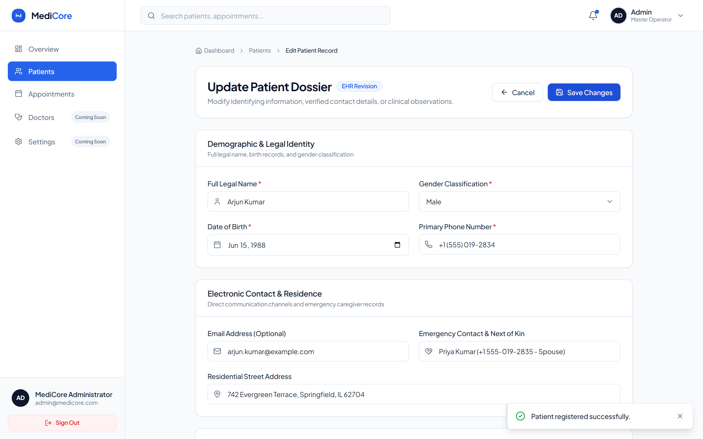 |
| <sub><b>Figure 3C:</b> Validated intake form with automated patient code assignment (`P001`, `P002`...).</sub> | <sub><b>Figure 3D:</b> Record modification interface with pre-populated fields and instant persistence.</sub> |

---

### 4. Consultation & Appointment Scheduling

Relational scheduling connecting patients to specialist doctors with date constraints, time slots, clinical reasons, and color-coded status badges (`Pending` ➔ `Confirmed` ➔ `Completed` ➔ `Cancelled`).

| Appointment Master Table | Create Relational Appointment |
| :---: | :---: |
| 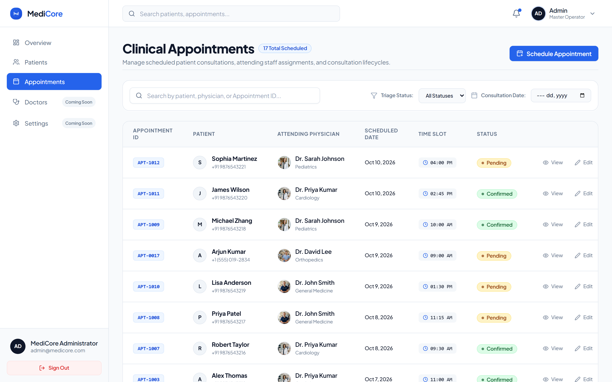 | 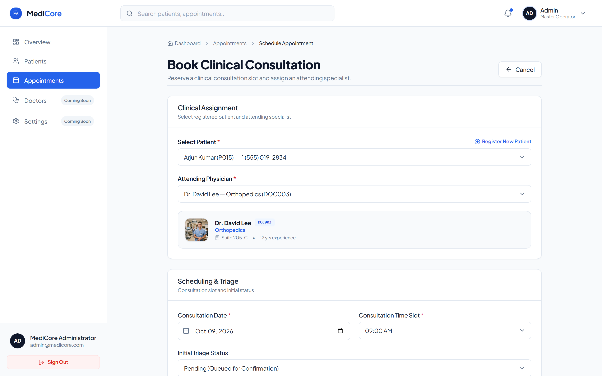 |
| <sub><b>Figure 4A:</b> Appointments table with status filters, date selection, and quick action controls.</sub> | <sub><b>Figure 4B:</b> Scheduling modal linking registered patients with active clinical specialists.</sub> |

<p align="center">
  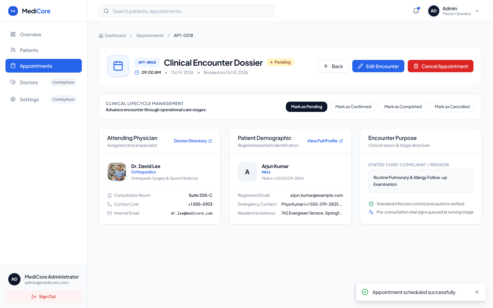
  <br />
  <em>Figure 4C: Detailed consultation dossier displaying populated doctor specialty, patient demographics, and 1-click status lifecycle controls.</em>
</p>

---

### 5. Clinical Roster & Administration Previews

Architected for future enterprise expansion: active seeded medical specialists alongside clearly demarcated roadmap previews for Phase 2 credentialing and HIPAA configuration.

| Active Doctor Roster (Phase 2 Preview) | System Settings & Audit (Phase 2 Preview) |
| :---: | :---: |
| 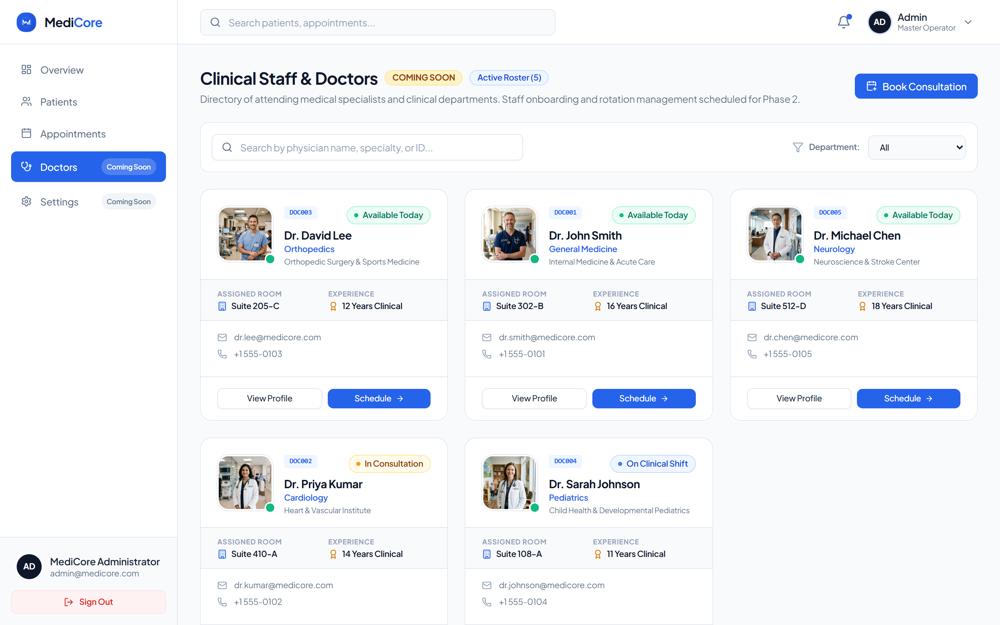 | 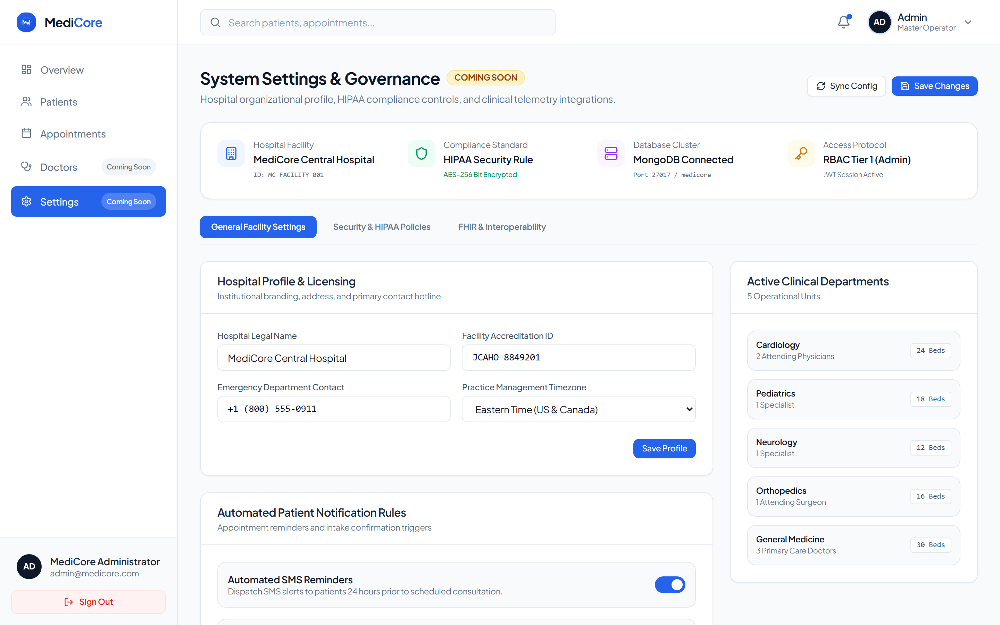 |
| <sub><b>Figure 5A:</b> Active specialist roster with credentials and upcoming self-service physician portal preview.</sub> | <sub><b>Figure 5B:</b> System configuration interface with HIPAA audit logging and EHR integration roadmap.</sub> |

---

### 6. Responsive Mobile Experience

Engineered with mobile-first Tailwind CSS breakpoints (`sm`, `md`, `lg`, `xl`), providing clinical staff with seamless usability on tablets and mobile devices.

| Mobile Dashboard | Mobile Patient Directory | Mobile Appointments Roster |
| :---: | :---: | :---: |
| 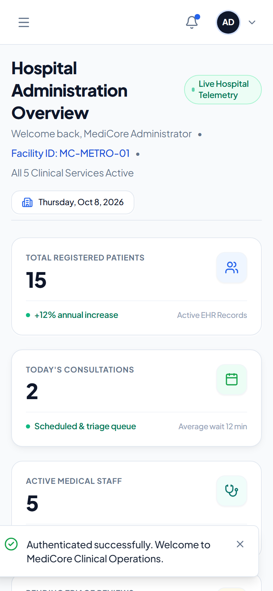 | 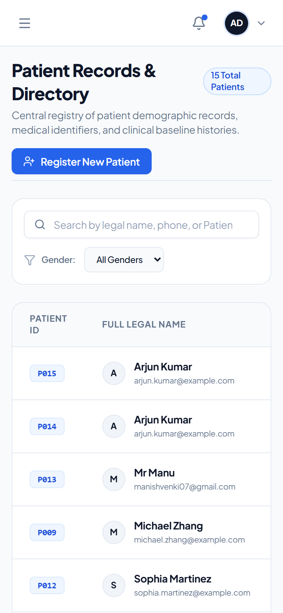 | 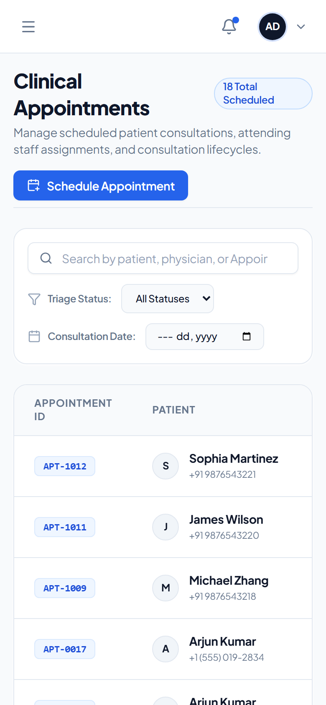 |
| <sub><b>Figure 6A:</b> Responsive KPI grid & volume charts on mobile viewport.</sub> | <sub><b>Figure 6B:</b> Mobile card list with touch-friendly actions and search.</sub> | <sub><b>Figure 6C:</b> Compact appointment agenda with quick status indicators.</sub> |

---

## Feature Status: Implemented vs. Planned

MediCore clearly distinguishes between functionality verified in the existing codebase and planned roadmap modules.

### Currently Implemented (Verified MVP)

The current implementation is an **Admin-focused Healthcare Management MVP** delivering verified core capabilities:

- [x] **Secure Administrator Authentication**:
  - `bcryptjs` salt hashing (10 rounds) for password storage.
  - Stateless JSON Web Tokens (`jsonwebtoken`) with 7-day expiration.
  - Client-side `<ProtectedRoute>` route wrapper.
  - Automatic session cleanup and redirect to `/login` upon HTTP `401 Unauthorized`.
  - Accessible password visibility toggle (`Eye`/`EyeOff`).
  - *(Visualized in [Figure 1](screenshots/01-login.png))*
- [x] **Executive KPI Analytics & Agenda Dashboard**:
  - Real-time database counters (Total Patients, Today's Scheduled Appointments, Total Doctors, Pending Consultations).
  - Weekly appointment volume bar chart using `recharts`.
  - Today's consultation agenda with status indicators.
  - *(Visualized in [Figure 2A & 2B](screenshots/02-dashboard.png))*
- [x] **Patient Information Management System (PIMS)**:
  - Full CRUD operations with Mongoose schema validation.
  - Automatic sequential patient code generator (`P001`, `P002`...).
  - Multi-field debounced query against name, phone, email, and ID code.
  - Demographic filtering by gender.
  - Computed virtual `age` field automatically derived from `dateOfBirth`.
  - Two-step deletion modal guard with relational cascade cleanup of associated appointments.
  - *(Visualized in [Figures 3A, 3B, 3C, 3D](screenshots/03-patients-list.png))*
- [x] **Relational Consultation & Appointment Scheduler**:
  - Relational joins connecting `Patient` and `Doctor` document references.
  - Past-date scheduling guard preventing appointments in past calendar dates.
  - 1-click status transitions (`Pending` ➔ `Confirmed` ➔ `Completed` ➔ `Cancelled`).
  - Filter and query appointments by doctor, patient, status, and calendar date.
  - *(Visualized in [Figures 4A, 4B, 4C](screenshots/07-appointments-list.png))*
- [x] **Dual-Engine Database Architecture**:
  - Direct connection to MongoDB Atlas or local MongoDB via `MONGODB_URI`.
  - Automatic zero-configuration fallback to an embedded in-memory database (`mongodb-memory-server`) if external MongoDB is unreachable.
  - Startup database auto-seeder (`seed.ts`) populating administrator credentials, 5 clinical doctors, 10 patients, and 12 relational appointments.
- [x] **Responsive Mobile Layout**:
  - Full touch-friendly responsive interface optimized for desktop, tablet, and mobile clinical viewports.
  - *(Visualized in [Figures 6A, 6B, 6C](screenshots/12-responsive-mobile-dashboard.png))*

### Planned / Coming Soon

The following capabilities represent the planned product vision:

- [ ] **Patient Portal & Registration**: Self-service registration, patient login, and profile management.
- [ ] **Online Appointment Booking From Home**: Direct booking by patients without visiting the clinic.
- [ ] **Doctor Discovery & Real-Time Availability**: Patient-facing search by specialty, physician, and open slots.
- [ ] **Personalized Patient Dashboard**: Patient view of upcoming consultations, past history, and booking status.
- [ ] **Automated Booking Confirmations & Reminders**: Multi-channel notifications via email, SMS, and in-app alerts.
- [ ] **Self-Service Rescheduling & Cancellation**: Managed within healthcare-provider cancellation rules.
- [ ] **Online Consultations & Telehealth**: WebRTC virtual consultations for remote clinical care.
- [ ] **Secure Medical History & Document Access**: Patient access to prescriptions, doctor notes, and diagnostic reports.
- [ ] **Digital Payments & Receipts**: Optional integrated appointment booking deposits and invoice payments.

---

## Future Roadmap: Patient Portal & Digital Healthcare Experience

> [!IMPORTANT]
> **Roadmap Notice**: The modules in this section represent the architectural design for MediCore’s upcoming releases. All capabilities described here are **Planned** or **Coming Soon** and build upon the existing data models and API foundation.

```
┌────────────────────────────────────────────────────────────────────────┐
│                        MediCore Digital Ecosystem                      │
│                                                                        │
│   ┌────────────────────────┐             ┌─────────────────────────┐   │
│   │   Admin & Staff MVP    │             │  Patient Portal (Phase 2)│  │
│   │  [CURRENTLY LIVE]      │             │  [PLANNED / COMING SOON]│   │
│   │ • Executive Dashboard  │             │ • Home Booking Engine   │   │
│   │ • Patient Records CRUD │   REST API  │ • Doctor Discovery      │   │
│   │ • Relational Calendar  │◄───────────►│ • Personal Dashboard    │   │
│   │ • Doctor Roster        │             │ • Automated Reminders   │   │
│   │ • In-Memory Fallback   │             │ • Teleconsultation Links│   │
│   └────────────────────────┘             └─────────────────────────┘   │
└────────────────────────────────────────────────────────────────────────┘
```

### A. Patient Registration and Authentication
*Status: Planned / Upcoming Release*

A dedicated patient-facing authentication module expanding upon MediCore's existing JWT infrastructure:
- **Self-Service Registration**: Patients create an account with email verification, phone validation, and basic demographic intake.
- **Secure Sign-In & Session Isolation**: Dedicated patient role (`UserRole: 'PATIENT'`) strictly guarded so patients cannot access administrative endpoints (`/api/dashboard`, `/api/patients`).
- **Profile Management**: Patients can update emergency contacts, residential addresses, and notification preferences.
- **Self-Service Password Recovery**: Secure, time-limited tokenized email recovery links.
- **Privacy & Consent Controls**: Granular consent settings for data processing and notification preferences in compliance with health data privacy guidelines.

### B. Book Appointments From Home
*Status: Planned / Upcoming Release*

The core pillar of MediCore’s digital expansion: enabling patients to arrange outpatient consultations from the comfort of their homes without having to visit the clinic or wait in telephone queues.

#### The 8-Step Home Booking Workflow
1. **Portal Authentication**: Patient logs into the MediCore Patient Portal from any desktop, tablet, or smartphone.
2. **Search Doctors or Specialties**: Patient selects a medical specialty (e.g., Cardiology, Orthopedics, Pediatrics) or searches for a specific physician.
3. **Inspect Provider Credentials & Open Slots**: Patient views the physician’s verified bio, qualifications, clinic room, and real-time open calendar slots.
4. **Select Date & Time**: Patient selects an open appointment date and specific consultation window.
5. **Choose Consultation Mode**: Patient selects between an **In-Person Clinic Visit** or a **Virtual Online Consultation** (if supported by the provider).
6. **Enter Clinical Context & Confirm**: Patient enters the primary reason for consultation, notes any acute symptoms, and reviews booking terms.
7. **Instant Booking Confirmation**: The system checks slot concurrency, reserves the slot, and generates an official appointment confirmation with a unique reference number (`APT-XXXX`).
8. **Dashboard & Notification Sync**: The consultation appears immediately in the patient’s personalized dashboard, synchronizes with the clinic’s master calendar, and dispatches a confirmation notice.

> [!TIP]
> **Conflict Prevention Engine**: The booking service will enforce atomic slot locking to prevent race conditions and double-booking between concurrent patient requests.

### C. Personalized Patient Dashboard
*Status: Planned / Upcoming Release*

A dedicated, patient-tailored dashboard delivering complete clarity over their care schedule:
- **Upcoming Consultations Card**: Chronological list of confirmed consultations displaying date, time, doctor name, clinic room, or virtual consultation link.
- **Consultation History**: Historical archive of completed and past visits with attending doctors.
- **Real-Time Booking Status**: Color-coded status badges (`Pending Provider Review`, `Confirmed`, `Completed`, `Rescheduled`, `Cancelled`).
- **Self-Service Rescheduling & Cancellation**: Permitted within clinic policy constraints (e.g., rescheduling permitted up to 24 hours prior to the slot).
- **Authorized Document Access**: Downloadable appointment confirmation slips and physician-approved visit summaries.

### D. Doctor Discovery and Availability
*Status: Planned / Upcoming Release*

A patient-friendly physician directory building on MediCore’s existing seeded doctor roster:
- **Specialty Filtering**: Filter providers across Cardiology, General Medicine, Neurology, Orthopedics, Pediatrics, and Dermatology.
- **Doctor Profile Dossiers**: View qualifications, clinical focus, languages spoken, and clinic hours.
- **Real-Time Availability Calendar**: Calendar view displaying only genuinely open appointment slots, automatically excluding booked slots, doctor leave, and non-working hours.
- **Consultation Type Badges**: Clear visual indicators denoting whether a specialist accepts in-person visits, teleconsultations, or both.

### E. Notifications and Reminders
*Status: Planned / Multi-Channel Pipeline*

Automated notifications to minimize clinic no-shows and keep patients informed:
- **Immediate Booking Confirmation**: Dispatched immediately upon successful reservation with the consultation reference code.
- **Provider Status Updates**: Notifies the patient if a clinic adjusts the consultation time or updates the status to `Confirmed`.
- **24-Hour & 2-Hour Appointment Reminders**: Scheduled reminders to ensure patients arrive on time or connect to their virtual room.
- **Cancellation / Reschedule Notices**: Instant confirmation whenever a consultation is altered.
- *Delivery Channels (Planned)*: In-app notification center, transactional email (via SendGrid/AWS SES), and optional SMS alerts.

### F. Online Consultation — Future Telehealth Extension
*Status: Planned / Telehealth Extension*

A remote clinical consultation extension for patients who cannot travel or prefer remote follow-ups:
- **Secure Telehealth Scheduling**: Patients filter specifically for virtual slots.
- **One-Click Virtual Consultation Link**: Unique, end-to-end encrypted WebRTC room link generated alongside the appointment confirmation.
- **Consultation Status Synchronization**: Doctor and patient connect to the virtual room; completion transitions the appointment status to `Completed`.
- **Protected Virtual Records**: Telehealth access tokens expire immediately following consultation completion.

### G. Patient Records and Medical History
*Status: Planned / Sensitive Health Data Architecture*

A secure clinical record repository enabling authorized patients to access their health records:
- **Consultation Summaries**: Doctor-approved notes summarizing the outcome of visits.
- **Digital Prescriptions (e-Rx)**: Electronic prescriptions detailing medication name, dosage, frequency, and instructions.
- **Diagnostic Report Repository**: View laboratory and imaging reports uploaded by clinical staff.
- **Strict Clinical Integrity Controls**: Official medical records, diagnoses, and prescriptions are strictly read-only for patients and can only be authored or amended by licensed clinical providers.
- **Healthcare Privacy Architecture**: All health records are architected around strict authorization guards, field-level encryption, access audit logging, and data minimization principles.

### H. Appointment Management for Healthcare Providers
*Status: Planned / Provider Workflow Integration*

Seamless bi-directional integration between the Patient Portal and MediCore’s existing administrative scheduler:
- **Review Incoming Requests**: Providers and receptionists can review online patient requests, confirm bookings, or suggest alternative times.
- **Availability Management**: Doctors can toggle working hours, mark vacation leave, and dynamically block unavailable time slots.
- **Unified Master Calendar**: Synchronizes bookings made by administrative receptionists and home bookings made by patients into a single consolidated agenda.
- **Patient Dossier Linking**: Online bookings link directly to existing patient dossiers or trigger verified intake for first-time visitors.

### I. Future Payments — Optional Enhancement
*Status: Optional / Planned Extension*

An optional payment processing extension for clinics that require consultation deposits:
- **Digital Payment Processing**: Support for credit/debit cards, UPI, or digital wallets via standard payment gateways (Stripe/Razorpay).
- **Automated Invoices & Receipts**: Instant PDF receipts with consultation reference numbers.
- **Refund Policy Enforcement**: Automated refund handling when appointments are cancelled within provider policy windows.
- *Note: Payment integrations are strictly planned and optional; no live financial credentials are configured.*

---

### Proposed Patient Appointment Booking Flowchart

The Mermaid diagram below visualizes the proposed end-to-end patient booking journey from portal authentication to post-booking reminders:

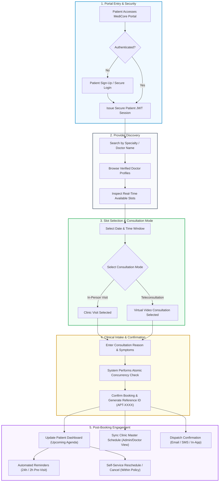

---

## Technology Stack

### Frontend Architecture
| Technology | Version | Purpose |
| :--- | :--- | :--- |
| **React** | `^19.2.8` | Component-based reactive UI rendering |
| **Vite** | `^8.3.0` | Ultra-fast build tool and local development HMR server |
| **TypeScript** | `~6.0.2` | End-to-end static type safety and contract enforcement |
| **Tailwind CSS** | `^3.4.19` | Utility-first styling with custom clinical color palette |
| **React Router** | `^7.18.4` | Client-side routing with guarded layout wrappers |
| **Recharts** | `^3.10.1` | Declarative SVG charting for consultation statistics |
| **Lucide React** | `^1.52.0` | Accessible, consistent icon library |
| **Axios** | `^1.20.0` | Promise-based HTTP client with auth interceptors |
| **Oxlint** | `^1.81.0` | High-performance static JavaScript/TypeScript linter |

### Backend Architecture
| Technology | Version | Purpose |
| :--- | :--- | :--- |
| **Node.js** | `18+` / `20+` | Server JavaScript runtime environment |
| **Express.js** | `^4.19.2` | RESTful HTTP routing framework and middleware pipeline |
| **TypeScript** | `^5.5.3` | Strongly-typed backend controller, model, and route logic |
| **Mongoose** | `^8.5.1` | Object Data Modeling (ODM) for MongoDB schemas and virtuals |
| **bcryptjs** | `^2.4.3` | Cryptographic password hashing (10 salt rounds) |
| **jsonwebtoken** | `^9.0.2` | Stateless HMAC-SHA256 bearer token authentication |
| **CORS** | `^2.8.5` | Cross-Origin Resource Sharing middleware |
| **dotenv** | `^16.4.5` | Twelve-factor application environment configuration |
| **ts-node-dev** | `^2.0.0` | Live-reloading TypeScript execution for development |

### Persistence & Storage
| Technology | Version | Purpose |
| :--- | :--- | :--- |
| **MongoDB Atlas** | `v6.0+` | Scalable cloud document database for production |
| **Local MongoDB** | `v6.0+` | Standard local database daemon on port 27017 |
| **MongoMemoryServer** | `^9.4.0` | In-memory zero-configuration MongoDB engine fallback |

### Quality Assurance & DevOps
| Technology | Version | Purpose |
| :--- | :--- | :--- |
| **Playwright** | `^1.64.0` | Headless Chromium end-to-end testing & screenshot automation |
| **Concurrently** | `^9.1.2` | Unified multi-process execution for full-stack dev |
| **PowerShell & Batch** | Native | 1-click Windows execution scripts (`run.ps1`, `run.bat`) |

---

## System Architecture & Data Flow

### Architecture Overview

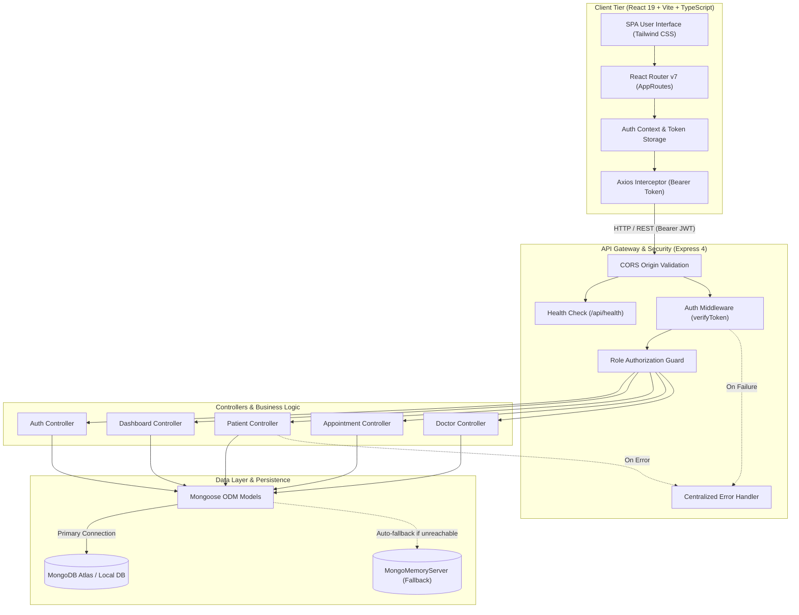

### Data Flow Lifecycle

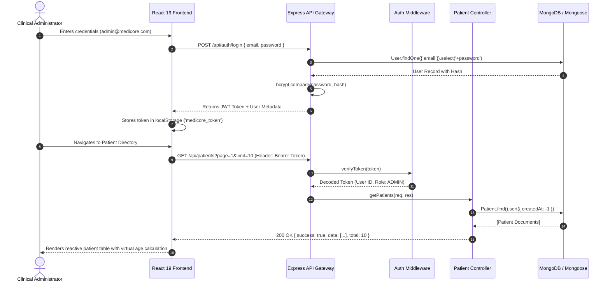

---

## Database & Data Models

### Entity-Relationship Diagram (ERD)

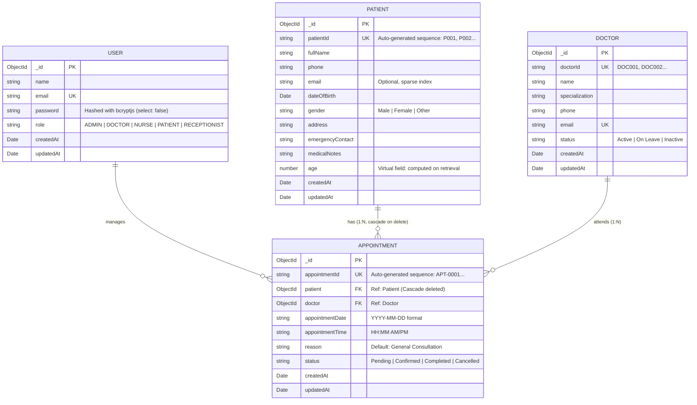

### Schema Details & Indexes

1. **User Schema (`User.ts`)**:
   - `email`: Indexed, unique, lowercase, trimmed.
   - `password`: Excluded by default (`select: false`), hashed before persistence via Mongoose pre-save hook.
   - `role`: Enum constraint (`'ADMIN'`, `'DOCTOR'`, `'NURSE'`, `'PATIENT'`, `'RECEPTIONIST'`).
2. **Patient Schema (`Patient.ts`)**:
   - `patientId`: Indexed, unique, sequentially formatted (`P001`, `P002`...).
   - `phone` & `fullName`: Indexed for rapid substring search regex.
   - Virtual `age`: Calculated automatically from `dateOfBirth` relative to current system date on serialization.
   - Cascading Cleanup: Deleting a patient invokes `Appointment.deleteMany({ patient: patient._id })` before removing the dossier.
3. **Doctor Schema (`Doctor.ts`)**:
   - `doctorId`: Unique identifier (`DOC001`, `DOC002`...).
   - `status`: Enum constraint (`'Active'`, `'On Leave'`, `'Inactive'`).
4. **Appointment Schema (`Appointment.ts`)**:
   - `appointmentId`: Unique identifier (`APT-0001`, `APT-0002`...).
   - `patient` & `doctor`: Indexed `Schema.Types.ObjectId` references populated via Mongoose `.populate()`.
   - `appointmentDate`: Indexed string format (`YYYY-MM-DD`) supporting day-level filtering.
   - `status`: Indexed enum constraint (`'Pending'`, `'Confirmed'`, `'Completed'`, `'Cancelled'`).

---

## REST API Reference

All protected endpoints require an HTTP header: `Authorization: Bearer <JWT_TOKEN>`.

### Authentication Endpoints (`/api/auth`)

| Method | Endpoint | Access | Description | Request Body |
| :--- | :--- | :--- | :--- | :--- |
| `POST` | `/api/auth/login` | Public | Authenticates credentials and issues JWT | `{"email": "admin@medicore.com", "password": "..."}` |
| `GET` | `/api/auth/me` | Bearer Token | Retrieves active authenticated user session | _None_ |

<details>
<summary>▶ View Sample Login Response</summary>

```json
{
  "success": true,
  "message": "Authentication successful.",
  "data": {
    "token": "eyJhbGciOiJIUzI1NiIsInR5cCI6IkpXVCJ9...",
    "user": {
      "id": "6704ca98b3f46f4812a10123",
      "name": "MediCore Administrator",
      "email": "admin@medicore.com",
      "role": "ADMIN"
    }
  }
}
```
</details>

---

### Dashboard Endpoints (`/api/dashboard`)

| Method | Endpoint | Access | Description | Query Parameters |
| :--- | :--- | :--- | :--- | :--- |
| `GET` | `/api/dashboard/stats` | Bearer Token | Live KPI counters (patients, appointments, doctors, pending) | _None_ |
| `GET` | `/api/dashboard/today-appointments` | Bearer Token | List of consultations scheduled for today (or nearest 6 active) | _None_ |
| `GET` | `/api/dashboard/appointment-statistics` | Bearer Token | Weekday breakdown of completed vs total appointments for chart | _None_ |

---

### Patient Endpoints (`/api/patients`)

| Method | Endpoint | Access | Description | Query Parameters / Body |
| :--- | :--- | :--- | :--- | :--- |
| `GET` | `/api/patients` | Bearer Token | Paginated query with multi-field search and gender filter | `?page=1&limit=10&search=Smith&gender=Male` |
| `GET` | `/api/patients/:id` | Bearer Token | Fetches complete patient dossier with virtual age | URL parameter `:id` |
| `POST` | `/api/patients` | Bearer Token | Creates new patient with auto-generated `patientId` | `{"fullName": "...", "phone": "...", "dateOfBirth": "...", "gender": "..."}` |
| `PUT` | `/api/patients/:id` | Bearer Token | Updates demographic and clinical record data | Partial or full patient fields |
| `DELETE` | `/api/patients/:id` | Bearer Token | Safely deletes patient record and cascades to appointments | URL parameter `:id` |

---

### Appointment Endpoints (`/api/appointments`)

| Method | Endpoint | Access | Description | Query Parameters / Body |
| :--- | :--- | :--- | :--- | :--- |
| `GET` | `/api/appointments` | Bearer Token | Paginated appointments with doctor and patient populated | `?page=1&limit=10&search=&status=Pending&date=` |
| `GET` | `/api/appointments/:id` | Bearer Token | Fetches full consultation dossier with populated references | URL parameter `:id` |
| `POST` | `/api/appointments` | Bearer Token | Schedules consultation (future date guard enforced) | `{"patient": "...", "doctor": "...", "appointmentDate": "...", "appointmentTime": "..."}` |
| `PUT` | `/api/appointments/:id` | Bearer Token | Modifies consultation details or transitions status | `{"status": "Confirmed"}` |
| `DELETE` | `/api/appointments/:id` | Bearer Token | Cancels and permanently removes appointment record | URL parameter `:id` |

---

### Doctor & System Endpoints (`/api/doctors`, `/api/health`)

| Method | Endpoint | Access | Description |
| :--- | :--- | :--- | :--- |
| `GET` | `/api/doctors` | Bearer Token | Retrieves active clinical doctor roster sorted by name |
| `GET` | `/api/health` | Public | System health check reporting uptime status and timestamp |

---

## Repository Structure

```
medicore/
├── client/                                 # Frontend SPA (React 19 + Vite + TypeScript)
│   ├── public/                             # Static assets, SVG icons, and hero photography
│   │   ├── images/                         # Physician profile portraits & login graphics
│   │   ├── favicon.svg                     # MediCore brand SVG icon
│   │   └── icons.svg                       # Vector sprites
│   ├── src/
│   │   ├── assets/                         # Vector branding assets
│   │   ├── components/
│   │   │   ├── common/                     # Button, Input, Select, Modal, ConfirmDialog, Skeletons
│   │   │   ├── dashboard/                  # StatCard, AppointmentTable, AppointmentChart, QuickActionCard
│   │   │   └── layout/                     # AppLayout, Header, Sidebar, Navigation Items
│   │   ├── context/                        # AuthContext (JWT state), ToastContext (user feedback)
│   │   ├── hooks/                          # useAuth, useToast, useDebounce custom hooks
│   │   ├── pages/                          # Login, Dashboard, Patients, Appointments, Doctors, Settings
│   │   ├── routes/                         # AppRoutes.tsx, ProtectedRoute.tsx (access guards)
│   │   ├── services/                       # api.ts (Axios), authService, patientService, appointmentService
│   │   ├── types/                          # TypeScript contracts (IPatient, IAppointment, IDoctor, IUser)
│   │   ├── utils/                          # Age calculation, currency, date formatting helpers
│   │   ├── App.tsx                         # Top-level React provider tree
│   │   ├── main.tsx                        # DOM mount root
│   │   └── index.css                       # Tailwind directives and clinical design tokens
│   ├── tailwind.config.js                  # Custom palette extensions
│   ├── tsconfig.json                       # Client TypeScript configuration
│   └── vite.config.ts                      # Vite build plugins and dev proxy configuration
│
├── server/                                 # Backend REST API (Node.js + Express + TypeScript)
│   ├── src/
│   │   ├── config/
│   │   │   └── db.ts                       # Dual-engine connection (MongoDB Atlas + MongoMemoryServer)
│   │   ├── controllers/
│   │   │   ├── authController.ts           # Login verification, session me, token generation
│   │   │   ├── dashboardController.ts      # KPI aggregation, weekly statistics, agenda
│   │   │   ├── patientController.ts        # PIMS CRUD, debounced query, auto-ID sequence, cascade delete
│   │   │   ├── appointmentController.ts    # Relational scheduling, past-date guards, status transitions
│   │   │   └── doctorController.ts         # Active medical specialist roster query
│   │   ├── middleware/
│   │   │   ├── authMiddleware.ts           # Bearer token verification and role guards
│   │   │   └── errorHandler.ts             # Centralized HTTP error sanitization
│   │   ├── models/
│   │   │   ├── User.ts                     # Admin credentials, bcrypt hooks, role enum
│   │   │   ├── Patient.ts                  # Patient demographics, medical notes, virtual age
│   │   │   ├── Doctor.ts                   # Physician credentials, specialties, availability
│   │   │   └── Appointment.ts              # Relational consultation linkage with date/status
│   │   ├── routes/                         # Express sub-routers mounted under /api/*
│   │   ├── services/
│   │   │   └── seed.ts                     # Automated clinical database seeder
│   │   ├── utils/
│   │   │   └── jwt.ts                      # JWT signing and verification utilities
│   │   ├── types/                          # Server TypeScript types and Express Request extensions
│   │   ├── app.ts                          # Express application configuration, CORS, routes
│   │   └── server.ts                       # HTTP server bootstrap and port listener
│   ├── tsconfig.json                       # Server TypeScript compiler options
│   └── .env.example                        # Server environment variable template
│
├── screenshots/                            # 15 high-definition Playwright test captures
├── scripts/
│   └── capture_screenshots.js              # Automated Playwright E2E runner & screenshot pipeline
├── run.bat                                 # Windows 1-Click Launch Script (Batch)
├── run.ps1                                 # Windows 1-Click Launch Script (PowerShell)
├── package.json                            # Root workspace scripts & concurrency orchestration
├── .env.example                            # Root environment variable template
├── .gitignore                              # Git exclusion rules
└── README.md                               # Project documentation
```

---

## Prerequisites

Before running MediCore, ensure your environment meets these runtime requirements:

| Dependency | Minimum Version | Recommended Version | Verification Command |
| :--- | :--- | :--- | :--- |
| **Node.js** | `v18.0.0` | `v20.x` or `v22.x` | `node -v` |
| **npm** | `v9.0.0` | `v10.x` | `npm -v` |
| **MongoDB** *(Optional)* | `v6.0+` | MongoDB Atlas or Local | `mongod --version` |

> [!NOTE]
> **No Database Installation Required!** If you do not have MongoDB installed or running locally, MediCore automatically initializes an embedded `MongoMemoryServer` engine in memory. You can run and evaluate the application immediately out of the box.

---

## Installation & Local Setup

### 1. Clone the Repository
```bash
git clone https://github.com/manishvenki/MediCore.git
cd MediCore
```

### 2. Install Dependencies
You can install dependencies across the entire workspace from the root:

```bash
# Install root orchestration packages
npm install

# Install server packages
npm install --prefix server

# Install client packages
npm install --prefix client
```

### 3. Configure Environment Variables
Copy the template files for both server and client:

```bash
# Server configuration
cp server/.env.example server/.env

# Client configuration
cp client/.env.example client/.env
```

*(On Windows PowerShell, use `Copy-Item server/.env.example server/.env` and `Copy-Item client/.env.example client/.env`)*

---

### 4. Running the Application

Choose any of the following verified execution methods:

#### Method A: Windows 1-Click Script (Recommended for Windows)
Double-click `run.bat` or execute in Command Prompt:
```cmd
.\run.bat
```
Or execute the PowerShell equivalent:
```powershell
.\run.ps1
```
*This launches the backend on port 5000 and the frontend on port 5173 in dedicated terminal windows, waits 4 seconds for database initialization, and automatically opens your default browser at `http://localhost:5173`.*

#### Method B: Unified Root Script (Cross-Platform)
From the project root:
```bash
npm run dev
```
*Uses `concurrently` to run both `dev:server` and `dev:client` in a single terminal with color-coded prefixes (`BACKEND` in blue, `FRONTEND` in green).*

#### Method C: Independent Terminal Execution

**Terminal 1 — Backend Server:**
```bash
cd server
npm run dev
# Server listening at http://localhost:5000
# Health check at http://localhost:5000/api/health
```

**Terminal 2 — Frontend Client:**
```bash
cd client
npm run dev
# Client running at http://localhost:5173
```

---

### 5. Accessing the Platform & Seed Credentials

Open your web browser and navigate to:
**`http://localhost:5173`**

On initial startup, MediCore's automatic database seeder initializes the clinical database with default demo records:

| Role | Email | Password | Pre-loaded Data |
| :--- | :--- | :--- | :--- |
| **Administrator** | `admin@medicore.com` | `Admin@123` | Full administrative access to dashboard, patients, and scheduling |

**Pre-Seeded Clinical Dataset**:
- **5 Medical Specialists**: Dr. John Smith (General Medicine), Dr. Priya Kumar (Cardiology), Dr. David Lee (Orthopedics), Dr. Sarah Johnson (Pediatrics), Dr. Michael Chen (Neurology).
- **10 Patients**: Realistic demographic records spanning varying age brackets, emergency contacts, and medical alerts.
- **12 Relational Consultations**: Distributed across past, present, and future dates with diverse consultation statuses (`Confirmed`, `Pending`, `Completed`, `Cancelled`).

---

## Environment Variables

### Server Configuration (`server/.env`)

| Variable | Type | Default / Example Value | Description |
| :--- | :--- | :--- | :--- |
| `PORT` | Number | `5000` | Port on which Express HTTP server listens |
| `NODE_ENV` | String | `development` | Environment mode (`development` or `production`) |
| `MONGODB_URI` | String | `mongodb://localhost:27017/medicore` | MongoDB connection URI. If unreachable, `MongoMemoryServer` starts automatically |
| `JWT_SECRET` | String | `medicore_super_secret_jwt_key_2026_demo` | Secret key used to sign and verify HMAC-SHA256 bearer tokens |
| `CLIENT_URL` | String | `http://localhost:5173` | Trusted frontend origin for CORS policy |

### Client Configuration (`client/.env`)

| Variable | Type | Default / Example Value | Description |
| :--- | :--- | :--- | :--- |
| `VITE_API_URL` | String | `http://localhost:5000/api` | Base URL of the backend REST API consumed by Axios |

> [!WARNING]
> **Production Notice**: Never commit production secrets, database credentials, or real JWT keys to version control. In production, provide strong random 256-bit strings for `JWT_SECRET` through your hosting provider's secrets manager.

---

## Testing & Quality Assurance

### Automated End-to-End Test & Screenshot Pipeline

MediCore includes an automated test script (`scripts/capture_screenshots.js`) built with **Playwright**. It validates full end-to-end user workflows and generates high-DPI screenshots:

```bash
# Ensure both backend (port 5000) and frontend (port 5173) are running, then run:
node scripts/capture_screenshots.js
```

**Automated Test Flow Verified by Script**:
1. Launches headless Chromium browser with 1440×900 desktop viewport (`deviceScaleFactor: 2`).
2. Navigates to `/login`, fills credentials, verifies password eye visibility toggle (`Eye`/`EyeOff`), and captures `01-login.png`.
3. Submits login, awaits session validation, and redirects to `/dashboard` to capture `02-dashboard.png`.
4. Navigates to `/patients`, verifies search and pagination, and captures `03-patients-list.png`.
5. Drills down into the first patient dossier, tests delete confirmation modal opening/cancellation, and captures `04-patient-details.png`.
6. Enters `/patients/new`, registers a new patient record with complete demographic fields, and captures `05-add-patient.png`.
7. Navigates to patient edit view, verifies pre-populated data, and captures `06-edit-patient.png`.
8. Navigates to `/appointments`, tests status and date filters, and captures `07-appointments-list.png`.
9. Opens `/appointments/new`, schedules a relational appointment connecting patient and physician, and captures `08-create-appointment.png`.
10. Views appointment consultation dossier and captures `09-appointment-details.png`.
11. Inspects roadmap preview modules at `/doctors` (`10-doctors-coming-soon.png`) and `/settings` (`11-settings-coming-soon.png`).
12. Resizes viewport to mobile dimensions (390×844) to validate responsive layouts across Dashboard, Patients, and Appointments (`12`, `13`, `14`).
13. Returns to executive dashboard to verify updated KPI counters and captures `15-final-dashboard-after-actions.png`.

### Code Verification & Build Commands

```bash
# Verify client code quality with Oxlint
npm run lint --prefix client

# Build and verify backend TypeScript compilation
npm run build:server

# Build and verify client TypeScript and Vite production bundle
npm run build:client

# Full workspace build verification
npm run build
```

---

## Security & Compliance

1. **Cryptographic Credential Protection**:
   - Administrative passwords are never stored in plaintext. Passwords undergo irreversible salt-hashed encryption via `bcryptjs` (10 rounds).
   - In Mongoose schemas, passwords use `{ select: false }` to prevent accidental inclusion in API queries or serialization.

2. **Stateless JWT Authorization**:
   - Standardized Bearer token verification via `authMiddleware.ts`.
   - Access to `/api/patients`, `/api/appointments`, `/api/dashboard`, and `/api/doctors` strictly guarded against unauthorized callers.

3. **CORS Isolation**:
   - Strict origin filtering allowing only trusted client applications (`http://localhost:5173` or configured `CLIENT_URL`) to access resources.

4. **Input Sanitization & Validation**:
   - Server-enforced required fields, date constraints, and enum checking guard against injection and corrupt states.
   - Front-end validation prevents invalid or past-dated consultation submissions.

5. **Safe Record Deletion**:
   - Two-step UI confirmation modal prevents accidental record destruction.
   - Deleting a patient triggers cascade cleanup to avoid orphaned appointment references in the database.

6. **Healthcare Privacy & Data Protection Considerations**:
   - Schema separation and field-level metadata are structured for audit logging.
   - Centralized error handling prevents leaking internal stack traces or database connection strings in responses.
   - Future patient-facing modules (medical histories, diagnostic reports, and teleconsultations) must strictly comply with applicable healthcare data protection, privacy, and confidentiality regulations (e.g., HIPAA / GDPR).

---

## Production Deployment

### Frontend Deployment (Vercel / Netlify / Cloudflare Pages)

1. Connect your repository to your hosting provider.
2. Configure build settings:
   - **Root Directory**: `client`
   - **Build Command**: `npm run build`
   - **Output Directory**: `dist`
3. Add Environment Variable:
   - `VITE_API_URL`: `https://your-backend-api.onrender.com/api`
4. Set up client-side rewrite rule for single-page applications:
   - **Vercel** (`client/vercel.json`):
     ```json
     {
       "rewrites": [{ "source": "/(.*)", "destination": "/index.html" }]
     }
     ```
   - **Netlify** (`client/_redirects`):
     ```text
     /*    /index.html   200
     ```

### Backend Deployment (Render / Railway / AWS / DigitalOcean)

1. Connect repository with root directory set to `server`.
2. Configure build and start commands:
   - **Build Command**: `npm install && npm run build`
   - **Start Command**: `npm start` (executes `node dist/server.js`)
3. Configure Production Environment Variables:
   - `PORT`: `5000` (or host assigned port)
   - `NODE_ENV`: `production`
   - `MONGODB_URI`: `mongodb+srv://<db_user>:<db_password>@cluster0.yourdomain.mongodb.net/medicore?retryWrites=true&w=majority`
   - `JWT_SECRET`: `<generated-secure-256-bit-token>`
   - `CLIENT_URL`: `https://your-medicore-frontend.vercel.app`

---

## Troubleshooting & FAQs

<details>
<summary><b>Q1: MongoDB is not installed locally. Will the project still run?</b></summary>
<br />
<b>Yes!</b> MediCore includes an embedded database fallback. If <code>MONGODB_URI</code> is absent or local MongoDB (port 27017) is not running, the server automatically starts an in-memory <code>MongoMemoryServer</code> instance. All schemas, seeding, queries, and mutations will work identically.
</details>

<details>
<summary><b>Q2: Getting <code>EADDRINUSE: address already in use :::5000</code>?</b></summary>
<br />
Another process is occupying port 5000. You can free port 5000 on Windows by running:
<pre><code>netstat -ano | findstr :5000
taskkill /PID &lt;PID&gt; /F</code></pre>
Alternatively, change <code>PORT=5001</code> in <code>server/.env</code> and update <code>VITE_API_URL=http://localhost:5001/api</code> in <code>client/.env</code>.
</details>

<details>
<summary><b>Q3: Windows localhost resolution issues with MongoDB?</b></summary>
<br />
On certain Windows systems, <code>localhost</code> resolves to IPv6 (<code>::1</code>) rather than IPv4 (<code>127.0.0.1</code>). MediCore's <code>db.ts</code> explicitly catches this exception and automatically retries with IPv4 (<code>127.0.0.1:27017</code>) before falling back to in-memory mode.
</details>

<details>
<summary><b>Q4: What happens if my JWT authentication token expires?</b></summary>
<br />
The client Axios response interceptor intercepts <code>401 Unauthorized</code> responses, clears stored session tokens from <code>localStorage</code>, and automatically redirects the user to <code>/login</code> with an informative session expiration notice.
</details>

---

## Strategic Platform Milestones

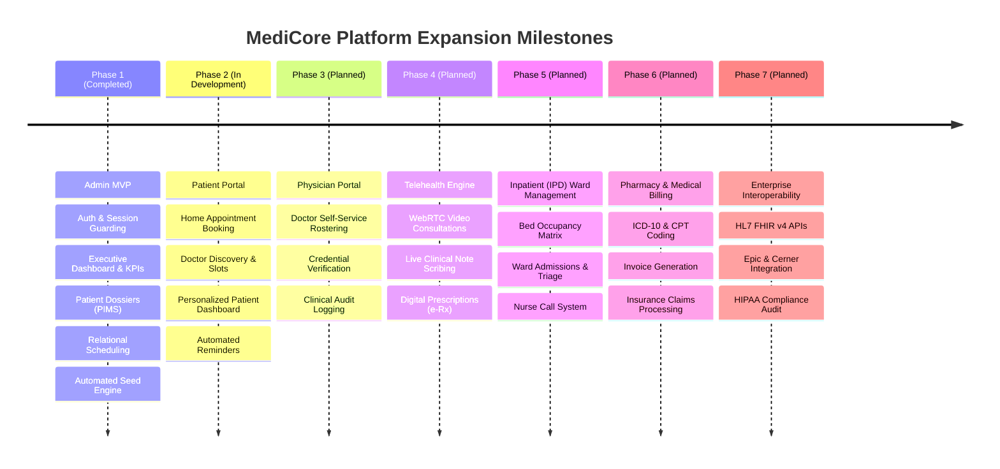

---

## Contributing

Contributions, issues, and feature requests are welcome! To contribute to MediCore:

1. **Fork the Repository** on GitHub.
2. **Create a Feature Branch**:
   ```bash
   git checkout -b feature/clinical-enhancement
   ```
3. **Commit Your Changes**:
   ```bash
   git commit -m "feat: implement doctor credential verification modal"
   ```
4. **Push to Your Branch**:
   ```bash
   git push origin feature/clinical-enhancement
   ```
5. **Open a Pull Request**: Submit your pull request to the `main` branch with a clear description of changes.

---

## License & Author

### License
This project is licensed under the **ISC License**. See the `package.json` specification for details.

### Author & Engineering
- **Project**: MediCore Healthcare Management Platform
- **Lead Developer**: **Manish Venki** ([GitHub Profile](https://github.com/manishvenki))
- **Repository**: [https://github.com/manishvenki/MediCore](https://github.com/manishvenki/MediCore)
- **Built With**: React 19, TypeScript, Tailwind CSS, Express.js, MongoDB Atlas, Mongoose, and Playwright.

---

<p align="center">
  <sub>MediCore Healthcare Management Platform &bull; Designed and engineered for clinical operational excellence.</sub>
</p>
